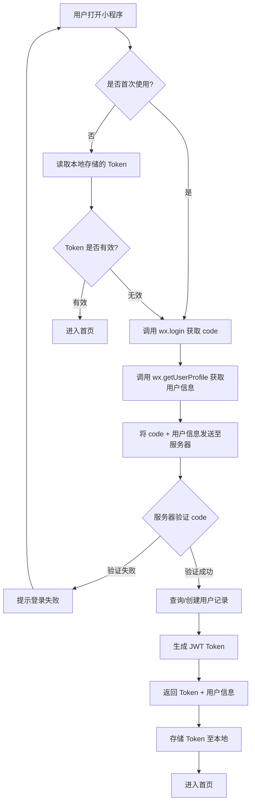
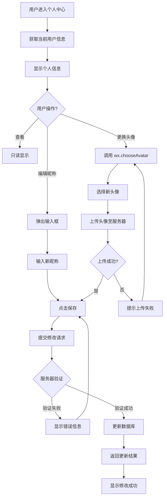
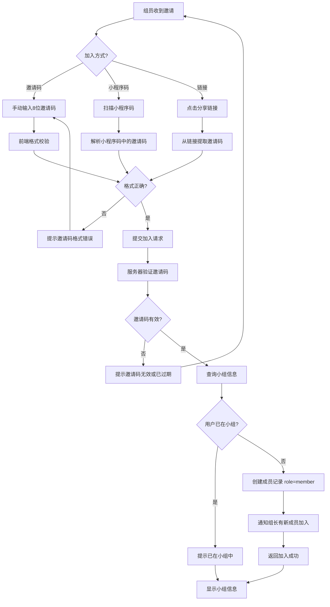
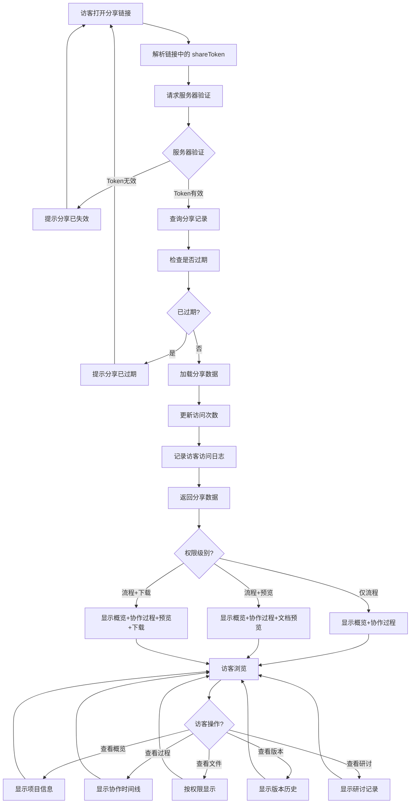
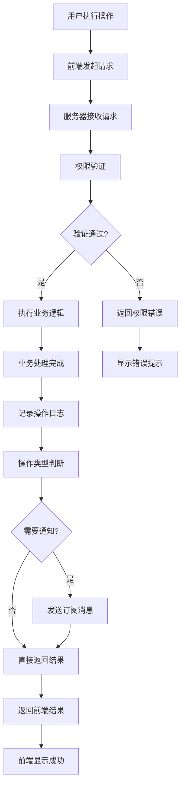
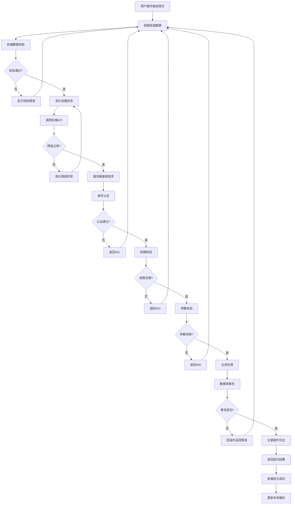
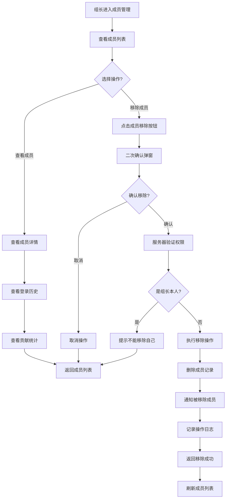
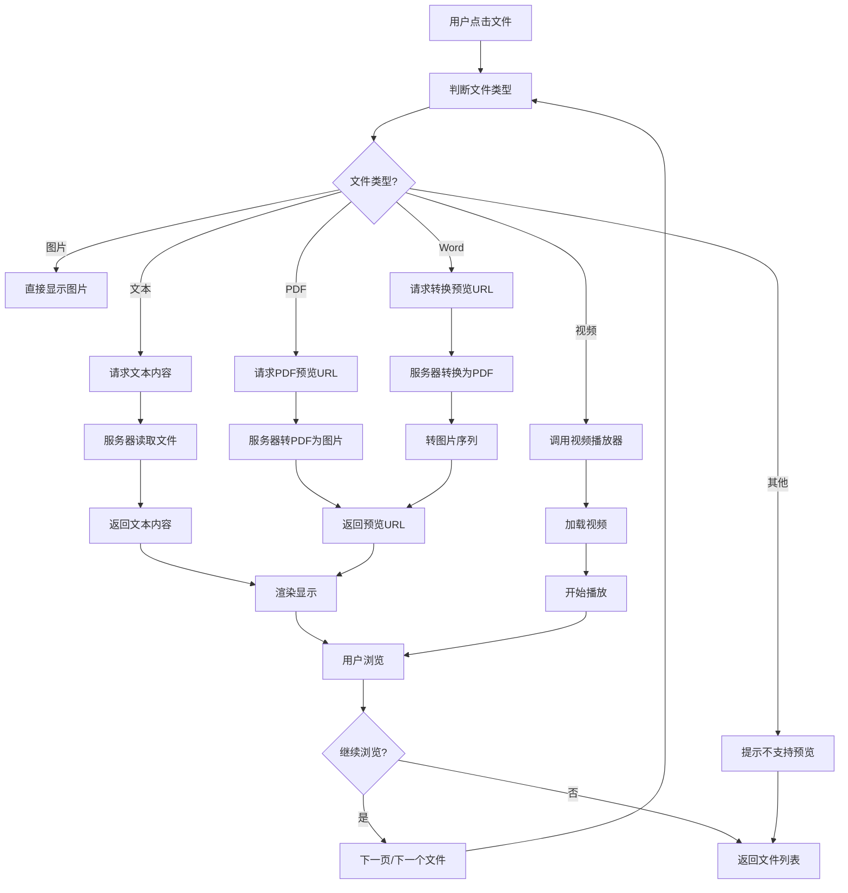

## 2.6 详细设计

### 2.6.1 业务流程设计

本节详细描述 ROC-git 课程小组文档协作管理平台的核心业务流程。每个流程都通过流程图+文字说明的形式进行完整描述。

#### 1. 用户登录流程

**流程说明**：用户通过微信小程序进行一键登录，系统自动获取用户身份信息。



**关键节点说明**：

| 步骤 | 操作 | 系统处理 | 异常处理 |
|------|------|----------|----------|
| 1 | 调用 wx.login | 获取临时 code | 网络异常则提示重试 |
| 2 | 调用 wx.getUserProfile | 获取昵称、头像 | 用户拒绝则使用默认头像 |
| 3 | 服务器验证 | 调用微信接口验证 code | 验证失败返回错误码 |
| 4 | 查询/创建用户 | 根据 openid 查询 | 不存在则创建新用户 |
| 5 | 生成 Token | 生成 JWT 包含用户信息 | Token 有效期 7 天 |
| 6 | 本地存储 | 写入 Storage | 存储失败则提示 |

#### 2. 修改个人信息流程

**流程说明**：用户可以查看和编辑个人基本信息（昵称、头像）。



**关键节点说明**：

| 步骤 | 操作 | 系统处理 | 异常处理 |
|------|------|----------|----------|
| 1 | 获取当前信息 | 调用 getUserInfo | 接口异常提示 |
| 2 | 编辑昵称 | 限制 1-20 字符 | 超长截断 |
| 3 | 更换头像 | 调用微信 chooseAvatar | 取消则不修改 |
| 4 | 上传头像 | 保存到云存储 | 失败重试机制 |
| 5 | 提交修改 | POST /api/user/profile | 验证失败返回 400 |

#### 3. 创建小组流程

**流程说明**：组长创建小组，并自动生成8位邀请码供组员加入。

```mermaid
flowchart TD
    A[用户点击"创建小组"] --> B[显示创建表单]
    B --> C[输入小组名称]
    C --> D[输入小组描述 可选]
    D --> E[点击"创建"]
    E --> F[前端校验表单]
    F --> G{校验通过?}
    G -->|否| H[显示校验错误]
    G -->|是| I[提交创建请求]
    I --> J[服务器创建小组记录]
    J --> K[生成8位随机邀请码]
    K --> L[将当前用户设为组长]
    L --> M[创建操作日志]
    M --> N[返回小组信息 + 邀请码]
    N --> O[前端显示创建成功]
    O --> P[显示邀请码和小程序码]
    P --> Q{用户操作?}
    Q -->|复制邀请码| R[复制到剪贴板]
    Q -->|分享小程序码| S[调用 wx.showShareMenu]
    Q -->|进入小组| T[跳转到小组主页]
    H --> C
```

**关键节点说明**：

| 步骤 | 操作 | 系统处理 | 异常处理 |
|------|------|----------|----------|
| 1 | 输入小组名称 | 限制 2-20 字符 | 含特殊字符提示 |
| 2 | 生成邀请码 | 8位字母数字组合 | 检查唯一性 |
| 3 | 设置权限 | 当前用户为 leader | 权限持久化 |
| 4 | 操作日志 | 记录创建动作 | 用于审计 |

#### 4. 加入小组流程

**流程说明**：组员通过邀请码或小程序码加入小组。



#### 5. 创建项目流程

**流程说明**：组长创建新项目，配置阶段模板和基础规则。

```mermaid
flowchart TD
    A[组长进入小组主页] --> B[点击"创建项目"]
    B --> C[选择创建方式]
    C --> D{创建方式?}
    D -->|空白创建| E[输入项目信息]
    D -->|使用模板| F[选择阶段模板]
    D -->|复制已有项目| G[选择源项目]
    E --> H[输入项目名称/描述]
    F --> I[加载模板阶段列表]
    G --> J[复制项目结构和数据]
    H --> K[配置项目规则]
    I --> K
    J --> K
    K --> L[配置审核规则]
    L --> M[配置提醒规则]
    M --> N[选择可见性]
    N --> O[点击"创建"]
    O --> P[前端校验]
    P --> Q{校验通过?}
    Q -->|否| R[显示错误]
    Q -->|是| S[提交创建请求]
    S --> T[服务器创建项目记录]
    T --> U[生成项目阶段]
    U --> V[创建默认任务列表]
    V --> W[记录操作日志]
    W --> X[返回项目信息]
    X --> Y[跳转到项目主页]
    R --> O
```

**关键节点说明**：

| 步骤 | 操作 | 系统处理 | 异常处理 |
|------|------|----------|----------|
| 1 | 选择创建方式 | 模板/空白/复制 | 复制需权限验证 |
| 2 | 配置项目信息 | 名称必填 描述可选 | 长度校验 |
| 3 | 配置审核规则 | 默认/自定义 | 保存至项目配置 |
| 4 | 生成阶段 | 根据模板生成 | 模板不存在则报错 |
| 5 | 创建任务 | 默认任务列表 | 异步处理 |

#### 6. 文件提交流程

**流程说明**：组员上传文件至项目指定阶段，文件进入待审核状态。

```mermaid
flowchart TD
    A[组员进入文件列表] --> B[点击"上传文件"]
    B --> C{选择文件来源?}
    C -->|本地相册| D[调用 wx.chooseMedia]
    C -->|微信聊天| E[调用 wx.chooseMessageFile]
    C -->|文档| F[调用 wx.chooseFile]
    D --> G[选择本地文件]
    E --> G
    F --> G
    G --> H[显示文件预览]
    H --> I[选择目标阶段]
    I --> J[填写文件说明 可选]
    J --> K[点击"上传"]
    K --> L[前端校验文件大小]
    L --> M{超过限制?}
    M -->|是| N[提示文件过大]
    M -->|否| O[显示上传进度]
    O --> P[分片上传至云存储]
    P --> Q{上传成功?}
    Q -->|否| R[显示上传失败]
    Q -->|是| S[服务器创建文件记录]
    S --> T[设置状态为 pending]
    T --> U[记录操作日志]
    U --> V[异步通知组长]
    V --> W[返回上传结果]
    W --> X[显示上传成功]
    N --> G
    R --> K
```

**关键节点说明**：

| 步骤 | 操作 | 系统处理 | 异常处理 |
|------|------|----------|----------|
| 1 | 选择文件 | 微信API调用 | 用户取消则退出 |
| 2 | 文件校验 | 大小≤50MB | 超限提示 |
| 3 | 选择阶段 | 阶段列表 | 必选校验 |
| 4 | 上传文件 | 分片上传 | 断点续传 |
| 5 | 创建记录 | status=pending | 事务保证 |
| 6 | 通知组长 | 订阅消息 | 失败降级 |

#### 7. 文件审核流程

**流程说明**：组长审核组员提交的文件，决定通过或驳回。

```mermaid
flowchart TD
    A[组长收到审核通知] --> B[进入审核中心]
    B --> C[获取待审核文件列表]
    C --> D[显示待审核文件]
    D --> E{审核方式?}
    E -->|逐个审核| F[点击单个文件]
    E -->|批量审核| G[多选文件]
    F --> H[查看文件详情]
    H --> I[预览文件内容]
    I --> J{审核决定?}
    J -->|通过| K[点击"通过"]
    J -->|驳回| L[点击"驳回"]
    L --> M[填写驳回原因]
    M --> K
    K --> N{批量?}
    N -->|是| O[遍历选中文件]
    N -->|否| P[提交单个审核]
    O --> P
    P --> Q[服务器验证权限]
    Q --> R{权限足够?}
    R -->|否| S[提示无权限]
    R -->|是| T[更新文件状态]
    T --> U[创建审核日志]
    U --> V[通知组员审核结果]
    V --> W[返回审核结果]
    W --> X[显示审核完成]
    G --> Y[选择多个文件]
    Y --> Z[选择批量操作]
    Z --> AA{批量操作?}
    AA -->|批量通过| K
    AA -->|批量驳回| L
    S --> F
```

**关键节点说明**：

| 步骤 | 操作 | 系统处理 | 异常处理 |
|------|------|----------|----------|
| 1 | 获取待审核 | 查询 status=pending | 权限验证 |
| 2 | 预览文件 | 调用预览API | 格式不支持提示 |
| 3 | 填写驳回原因 | 限制 5-200 字符 | 必填校验 |
| 4 | 批量操作 | 限制≤20个/次 | 超限提示 |
| 5 | 更新状态 | approved/rejected | 事务处理 |
| 6 | 通知组员 | 订阅消息 | 失败日志记录 |

#### 8. 任务分配流程

**流程说明**：组长创建任务并分配给指定成员，设置截止时间。

```mermaid
flowchart TD
    A[组长进入任务面板] --> B[点击"创建任务"]
    B --> C[显示任务创建表单]
    C --> D[输入任务名称]
    D --> E[输入任务描述]
    E --> F[选择负责人]
    F --> G[设置截止时间]
    G --> H[选择优先级]
    H --> I[关联文件 可选]
    I --> J[点击"分配"]
    J --> K[前端校验]
    K --> L{校验通过?}
    L -->|否| M[显示校验错误]
    L -->|是| N[提交任务创建]
    N --> O[服务器创建任务记录]
    O --> P[设置提醒规则]
    P --> Q[记录操作日志]
    Q --> R[通知被分配的成员]
    R --> S[返回创建结果]
    S --> T[显示分配成功]
    T --> U[跳转到任务详情]
    M --> J
```

**关键节点说明**：

| 步骤 | 操作 | 系统处理 | 异常处理 |
|------|------|----------|----------|
| 1 | 输入任务信息 | 名称必填 描述可选 | 长度校验 |
| 2 | 选择负责人 | 小组成员列表 | 仅可选成员 |
| 3 | 设置截止时间 | 日历选择器 | 必须未来时间 |
| 4 | 设置提醒 | 截止前3天/1天 | 默认开启 |
| 5 | 关联文件 | 可选附件 | 文件权限验证 |
| 6 | 通知成员 | 订阅消息 | 失败站内消息 |

#### 9. 任务完成流程

**流程说明**：组员完成任务，标记为已完成状态。

```mermaid
flowchart TD
    A[组员查看任务列表] --> B[点击目标任务]
    B --> C[查看任务详情]
    C --> D{任务状态?}
    D -->|已完成| E[显示完成信息]
    D -->|进行中| F[查看进度]
    F --> G{准备完成?}
    G -->|否| H[继续执行]
    G -->|是| I[点击"标记完成"]
    I --> J[填写完成说明]
    J --> K[上传完成凭证 可选]
    K --> L[提交完成]
    L --> M[服务器验证权限]
    M --> N{是任务负责人?}
    N -->|否| O[提示无权限]
    N -->|是| P[更新任务状态]
    P --> Q[记录完成时间]
    Q --> R[创建操作日志]
    R --> S[通知组长]
    S --> T[返回结果]
    T --> U[显示完成成功]
    H --> F
    O --> C
```

#### 10. 阶段成果更新流程

**流程说明**：组长记录每个阶段的成果产出。

```mermaid
flowchart TD
    A[组长进入项目主页] --> B[点击"阶段成果"]
    B --> C[查看各阶段成果列表]
    C --> D{操作?}
    D -->|查看历史| E[显示该阶段所有成果]
    D -->|新增成果| F[选择目标阶段]
    D -->|更新成果| G[选择已有成果]
    F --> H[填写成果标题]
    H --> I[填写成果描述]
    I --> J[关联文件 可选]
    J --> K[点击"保存"]
    G --> L[修改成果信息]
    L --> K
    K --> M[前端校验]
    M --> N{校验通过?}
    N -->|否| O[显示错误]
    N -->|是| P[提交保存]
    P --> Q[服务器创建/更新成果]
    Q --> R[更新阶段进度]
    R --> S[记录操作日志]
    S --> T[通知所有成员]
    T --> U[返回结果]
    U --> V[显示保存成功]
    O --> K
```

#### 11. 结项分享生成流程

**流程说明**：项目完成后，组长生成分享链接供访客查看。

```mermaid
flowchart TD
    A[项目完成] --> B[组长点击"结项"]
    B --> C[确认结项信息]
    C --> D[点击"确认结项"]
    D --> E[服务器更新项目状态]
    E --> F[归档所有文件]
    F --> G[生成项目总结数据]
    G --> H[返回结项成功]
    H --> I[进入分享设置页面]
    I --> J[选择分享权限级别]
    J --> K{权限级别?}
    K -->|仅流程| L[选择"仅查看流程"]
    K -->|流程+预览| M[选择"可预览"]
    K -->|流程+下载| N[选择"可下载"]
    L --> O[点击"生成分享链接"]
    M --> O
    N --> O
    O --> P[服务器生成 shareToken]
    P --> Q[创建分享记录]
    Q --> R[缓存分享数据到 Redis]
    R --> S[返回分享链接]
    S --> T[显示分享卡片]
    T --> U{分享方式?}
    U -->|复制链接| V[复制到剪贴板]
    U -->|分享到微信| W[调用 wx.showShareMenu]
    U -->|生成小程序码| X[调用 wx.canvasToTempFilePath]
    V --> Y[分享完成]
    W --> Y
    X --> Y
```

**关键节点说明**：

| 步骤 | 操作 | 系统处理 | 异常处理 |
|------|------|----------|----------|
| 1 | 确认结项 | 项目状态检查 | 未完成提示 |
| 2 | 归档文件 | 移动至归档表 | 事务保证 |
| 3 | 生成总结 | 聚合统计数据 | 异步处理 |
| 4 | 选择权限 | 3个级别 | 单选 |
| 5 | 生成 Token | 32位随机字符串 | 唯一性检查 |
| 6 | 缓存数据 | Redis 7天 | 缓存失败降级 |

#### 12. 访客访问分享流程

**流程说明**：访客通过分享链接查看项目协作过程和文件。



#### 13. 订阅消息授权流程

**流程说明**：用户订阅微信消息，以便及时接收通知。

```mermaid
flowchart TD
    A[用户进入消息中心] --> B[显示可订阅的消息类型]
    B --> C[用户勾选要订阅的类型]
    C --> D[点击"订阅"]
    D --> E{订阅方式?}
    E -->|一次性订阅| F[调用 wx.requestSubscribeMessage]
    E -->|长期订阅| G[调用长期订阅接口]
    F --> H[弹出微信订阅确认]
    G --> H
    H --> I{用户确认?}
    I -->|拒绝| J[提示订阅失败]
    I -->|允许| K[返回订阅结果]
    K --> L[提交订阅授权至服务器]
    L --> M[服务器保存订阅记录]
    M --> N[返回保存成功]
    N --> O[显示订阅成功]
    J --> B
```

#### 14. 操作日志记录流程

**流程说明**：系统自动记录所有重要操作，便于追溯。



#### 15. 数据提交流程（综合）

**流程说明**：用户提交各类数据（文件/任务/评论/成果等）的统一流程。



#### 16. 数据发布流程（项目结项分享发布）

**流程说明**：项目结项后发布分享链接的完整流程。

```mermaid
flowchart TD
    A[组长确认项目完成] --> B[检查所有任务状态]
    B --> C{所有任务完成?}
    C -->|否| D[提示未完成任务]
    C -->|是| E[检查所有文件状态]
    E --> F{文件都已审核?}
    F -->|否| G[提示待审核文件]
    F -->|是| H[显示结项确认弹窗]
    H --> I[填写结项总结]
    I --> J[点击"确认结项"]
    J --> K[服务器验证结项条件]
    K --> L{满足结项条件?}
    L -->|否| M[返回错误原因]
    L -->|是| N[更新项目状态为 completed]
    N --> O[归档项目数据]
    O --> P[生成项目总结报告]
    P --> Q[创建结项记录]
    Q --> R[通知所有成员]
    R --> S[返回结项成功]
    S --> T[进入分享发布页面]
    T --> U[选择分享权限]
    U --> V[生成分享链接]
    V --> W[分享发布]
    W --> X[显示分享卡片]
    D --> B
    G --> E
    M --> A
```

#### 17. 邀请成员流程

**流程说明**：组长邀请新成员加入小组，支持多种邀请方式。

```mermaid
flowchart TD
    A[组长进入小组主页] --> B[点击"邀请成员"]
    B --> C[选择邀请方式]
    C --> D{邀请方式?}
    D -->|邀请码| E[系统生成8位邀请码]
    D -->|小程序码| F[系统生成小程序码]
    D -->|分享链接| G[系统生成分享链接]
    E --> H[显示邀请信息]
    F --> H
    G --> H
    H --> I{操作?}
    I -->|复制邀请码| J[复制到剪贴板]
    I -->|保存小程序码| K[保存到相册]
    I -->|分享链接| L[调用分享菜单]
    J --> M[提示复制成功]
    K --> N[提示保存成功]
    L --> O[选择分享渠道]
    O --> P[分享成功]
    M --> Q[等待成员加入]
    N --> Q
    P --> Q
    Q --> R{有新成员加入?}
    R -->|是| S[系统通知组长]
    S --> T[显示新成员加入]
    R -->|否| U[持续等待]
```

**关键节点说明**：

| 步骤 | 操作 | 系统处理 | 异常处理 |
|------|------|----------|----------|
| 1 | 生成邀请码 | 8位随机字母数字 | 检查唯一性 |
| 2 | 生成小程序码 | 调用微信生成二维码 | 频率限制 |
| 3 | 分享链接 | 生成 URL Scheme | 有效期7天 |
| 4 | 成员加入 | 验证邀请码有效 | 邀请码失效提示 |

#### 18. 移除成员流程

**流程说明**：组长移除不活跃或已退出的成员。



#### 19. 变更组长流程

**流程说明**：组长将权限转移给其他成员。

```mermaid
flowchart TD
    A[组长进入设置] --> B[点击"变更组长"]
    B --> C[显示成员选择器]
    C --> D[选择新组长]
    D --> E{选择自己?}
    E -->|是| F[提示不能选择自己]
    E -->|否| G[显示确认信息]
    G --> H[确认变更]
    H --> I[二次身份验证]
    I --> J{验证通过?}
    J -->|否| K[提示验证失败]
    J -->|是| L[服务器执行变更]
    L --> M[更新权限关系]
    M --> N[原组长变为普通成员]
    N --> O[通知新组长]
    O --> P[通知所有成员]
    P --> Q[记录操作日志]
    Q --> R[返回变更成功]
    R --> S[跳转至新身份]
```

**关键节点说明**：

| 步骤 | 操作 | 系统处理 | 异常处理 |
|------|------|----------|----------|
| 1 | 选择新组长 | 仅显示组内成员 | 不能选自己 |
| 2 | 身份验证 | 密码/短信验证 | 验证失败限流 |
| 3 | 更新权限 | 事务保证一致性 | 失败回滚 |
| 4 | 通知 | 推送全员通知 | 异步发送 |

#### 20. 文件预览流程

**流程说明**：用户在小程序内预览各类文件。



**关键节点说明**：

| 步骤 | 操作 | 系统处理 | 异常处理 |
|------|------|----------|----------|
| 1 | 判断类型 | 识别MIME类型 | 类型识别失败 |
| 2 | 文本预览 | 直接读取内容 | 编码检测 |
| 3 | Office预览 | 转换为PDF图片 | 转换失败提示 |
| 4 | 视频播放 | 断点续播 | 网络波动重试 |

#### 21. 文件管理流程（删除/移动/收藏）

**流程说明**：用户对文件进行删除、移动、收藏操作。

```mermaid
flowchart TD
    A[用户进入文件列表] --> B[长按/勾选文件]
    B --> C[显示操作菜单]
    C --> D{选择操作?}
    D -->|删除| E[点击删除]
    D -->|移动| F[点击移动]
    D -->|收藏| G[点击收藏]
    D -->|批量| H[多选模式]
    E --> I[确认删除弹窗]
    I --> J{确认?}
    J -->|取消| K[取消操作]
    J -->|确认| L[权限校验]
    L --> M{有权限?}
    M -->|否| N[提示无权限]
    M -->|是| O[执行删除]
    O --> P[删除文件记录]
    P --> Q[记录操作日志]
    Q --> R[返回删除成功]
    R --> S[刷新文件列表]
    F --> T[显示阶段选择器]
    T --> U[选择目标阶段]
    U --> V[提交移动请求]
    V --> W[更新阶段关联]
    W --> X[记录操作日志]
    X --> Y[返回移动成功]
    Y --> S
    G --> Z[切换收藏状态]
    Z --> AA[保存状态]
    AA --> BB[更新UI显示]
    BB --> S
    H --> CC[进入批量选择]
    CC --> DD[勾选多个文件]
    DD --> C
    N --> S
    K --> S
```

#### 22. 版本管理全流程

**流程说明**：文件版本的创建、查看、对比和回溯。

```mermaid
flowchart TD
    A[用户上传新版本] --> B[上传文件]
    B --> C[自动生成版本号]
    C --> D[填写版本说明]
    D --> E[点击确认]
    E --> F[创建版本记录]
    F --> G[旧版本标记为历史]
    G --> H[新版本标记为最新]
    H --> I[记录操作日志]
    I --> J[返回上传成功]

    K[用户查看版本] --> L[进入文件详情]
    L --> M[点击版本历史]
    M --> N[获取版本列表]
    N --> O[显示版本时间线]
    O --> P{选择操作?}
    P -->|对比| Q[选择对比版本]
    Q --> R[请求版本差异]
    R --> S[显示差异对比视图]
    P -->|回溯| T[选择目标版本]
    T --> U[确认回溯]
    U --> V[创建新版本指向旧版本]
    V --> W[更新最新版本标识]
    W --> X[记录回溯日志]
    X --> Y[通知相关成员]
    Y --> Z[返回回溯成功]
```

**版本对比视图说明**：

| 文件类型 | 对比方式 | 显示效果 |
|----------|----------|----------|
| 文本文件(.txt/.md/.py) | 行级差异 | 高亮显示增删改行 |
| Office文档(.docx/.xlsx) | 转换后对比 | 页面并排显示 |
| 图片文件(.jpg/.png) | 缩略图对比 | 左右分栏显示 |
| PDF文件 | 页面对比 | 指定页面对照 |

#### 23. 文件检索与筛选流程

**流程说明**：用户通过多种条件检索和筛选文件。

```mermaid
flowchart TD
    A[用户进入文件列表] --> B[点击搜索框]
    B --> C[输入搜索关键词]
    C --> D[实时搜索建议]
    D --> E{选择建议?}
    E -->|是| F[点击建议词]
    E -->|否| G[手动输入完整]
    F --> H[执行搜索]
    G --> H
    H --> I[显示搜索结果]

    J[使用高级筛选] --> K[点击筛选按钮]
    K --> L[显示筛选面板]
    L --> M{筛选条件?}
    M -->|文件类型| N[选择类型：文档/图片/视频]
    M -->|所属阶段| O[选择阶段]
    M -->|上传者| P[选择成员]
    M -->|时间范围| Q[选择日期]
    M -->|审核状态| R[选择状态]
    N --> S[应用筛选]
    O --> S
    P --> S
    Q --> S
    R --> S
    S --> T[显示筛选结果]

    U[组合使用] --> V[先搜索关键词]
    V --> W[再添加筛选]
    W --> X[显示精筛结果]
    X --> Y[进一步操作]

    I --> Z[查看结果详情]
    T --> Z
    Y --> Z
    Z --> AA{找到目标?}
    AA -->|是| AB[点击文件]
    AA -->|否| AC[调整搜索词]
    AC --> C
    AB --> AD[进入文件详情]
```

**筛选组合示例**：

| 场景 | 搜索词 | 筛选条件 | 结果 |
|------|--------|----------|------|
| 需求文档 | 需求 | 阶段=需求分析 + 类型=文档 | 精准定位 |
| 组员贡献 | - | 上传者=张三 | 查看个人贡献 |
| 本周更新 | - | 时间=本周 | 最新文件 |
| 待审文件 | - | 状态=待审核 | 审核队列 |

#### 24. 消息通知与已读流程

**流程说明**：系统推送通知，用户管理消息已读状态。

```mermaid
flowchart TD
    A[系统触发事件] --> B{事件类型?}
    B -->|文件待审核| C[通知组长审核]
    B -->|审核完成| D[通知上传者结果]
    B -->|任务到期| E[通知任务负责人]
    B -->|成员变动| F[通知所有成员]
    B -->|阶段更新| G[通知关注成员]
    C --> H[组装消息内容]
    D --> H
    E --> H
    F --> H
    G --> H
    H --> I[查询订阅状态]
    I --> J{用户已订阅?}
    J -->|是| K[调用微信订阅API]
    J -->|否| L[发送站内消息]
    K --> M{发送成功?}
    M -->|是| N[记录发送日志]
    M -->|否| O[降级为站内消息]
    N --> P[消息送达用户]
    L --> P
    O --> P

    Q[用户打开消息中心] --> R[获取消息列表]
    R --> S[显示消息列表]
    S --> T{操作?}
    T -->|查看详情| U[点击消息]
    U --> V[跳转相关页面]
    T -->|单个已读| W[标记单条已读]
    W --> X[更新已读状态]
    X --> Y[刷新未读数]
    T -->|全部已读| Z[点击全部已读]
    Z --> AA[批量更新状态]
    AA --> AB[更新未读数显示]
    V --> AC[返回消息列表]
    Y --> AC
    AB --> AC
    AC --> T
```

**消息类型说明**：

| 类型 | 触发场景 | 推送方式 | 优先级 |
|------|----------|----------|--------|
| 审核通知 | 文件提交 | 订阅消息/站内 | 高 |
| 审核结果 | 组长审核 | 订阅消息/站内 | 高 |
| 任务提醒 | 截止前3天/1天 | 订阅消息 | 高 |
| 成员动态 | 加入/退出 | 站内消息 | 中 |
| 阶段成果 | 成果更新 | 站内消息 | 中 |
| 系统公告 | 平台通知 | 订阅消息 | 低 |

#### 25. 协作功能流程（研讨/决策/成果）

**流程说明**：团队进行研讨、记录决策、更新成果的完整流程。

```mermaid
flowchart TD
    A[组长进入协作中心] --> B{选择功能?}
    B -->|研讨记录| C[点击新建研讨]
    B -->|决策留存| D[点击新建决策]
    B -->|成果更新| E[点击更新成果]
    C --> F[填写研讨信息]
    F --> G[输入主题/时间/参与人]
    G --> H[记录研讨内容]
    H --> I[保存研讨记录]
    I --> J[创建研讨记录]
    J --> K[关联参与人员]
    K --> L[记录操作日志]
    L --> M[通知参与人]
    M --> N[返回创建成功]

    D --> O[填写决策信息]
    O --> P[输入标题/内容]
    P --> Q[关联研讨记录 可选]
    Q --> R[保存决策]
    R --> S[创建决策记录]
    S --> T[更新项目状态]
    T --> U[记录操作日志]
    U --> V[通知相关成员]
    V --> N

    E --> W[选择阶段]
    W --> X[填写成果信息]
    X --> Y[输入标题/描述]
    Y --> Z[关联相关文件]
    Z --> AA[上传成果凭证]
    AA --> AB[保存成果]
    AB --> AC[创建/更新成果记录]
    AC --> AD[更新阶段进度]
    AD --> AE[记录操作日志]
    AE --> AF[通知所有成员]
    AF --> N

    N --> AG[返回协作中心]
```

#### 26. 分享链接访问流程（访客视角）

**流程说明**：访客通过分享链接查看项目协作过程的完整流程。

```mermaid
flowchart TD
    A[访客点击分享链接] --> B[打开小程序/H5]
    B --> C[解析shareToken]
    C --> D[请求验证Token]
    D --> E{Token有效?}
    E -->|无效| F[提示链接已失效]
    E -->|有效| G[检查过期时间]
    G --> H{已过期?}
    H -->|是| I[提示链接已过期]
    H -->|否| J[加载项目数据]
    J --> K[获取项目基本信息]
    K --> L[获取成员列表]
    L --> M[获取阶段列表]
    M --> N[获取成果汇总]
    N --> O[获取操作日志]
    O --> P[组合返回数据]
    P --> Q[根据权限过滤内容]
    Q --> R{权限级别?}
    R -->|仅流程| S[返回概览+日志]
    R -->|流程+预览| T[额外返回文件预览]
    R -->|流程+下载| U[额外返回下载链接]

    S --> V[显示项目概览页]
    T --> V
    U --> V
    V --> W{访客操作?}
    W -->|查看概览| X[显示项目信息]
    W -->|查看过程| Y[显示协作时间线]
    W -->|查看成员| Z[显示团队成员]
    W -->|查看阶段| AA[显示阶段列表]
    W -->|查看成果| AB[显示阶段成果]
    W -->|查看文件| AC{有权限?}
    AC -->|预览| AD[预览文件]
    AC -->|下载| AE[下载文件]
    W -->|查看研讨| AF[显示研讨记录]
    W -->|查看版本| AG[显示版本历史]
    X --> V
    Y --> V
    Z --> V
    AA --> V
    AB --> V
    AD --> V
    AE --> V
    AF --> V
    AG --> V

    F --> AH[显示失效页面]
    I --> AH
    AH --> AI[提示联系分享者]
```

---

### 2.6.2 接口设计

本节定义 ROC-git 系统的所有 RESTful API 接口。所有接口均已在 `knife4j-spring` 项目中实际实现，可通过 `http://localhost:8080/doc.html` 在线查阅 API 文档。

#### 1. 接口设计规范

##### 1.1 基础规范

| 项目 | 规范 |
|------|------|
| **协议** | HTTPS（开发环境支持 HTTP） |
| **数据格式** | JSON |
| **字符编码** | UTF-8 |
| **接口前缀** | `/api/v1/` |
| **认证方式** | JWT Token（Header: `Authorization: Bearer <token>`） |
| **请求方法** | GET（查询） / POST（创建） / PUT（更新） / DELETE（删除） |
| **响应格式** | 统一 JSON 结构 |
| **文档地址** | `/doc.html`（Knife4j 增强 UI）|

##### 1.2 统一响应格式

**成功响应**：

```json
{
  "code": 0,
  "message": "success",
  "data": {
    // 业务数据
  },
  "timestamp": 1694697600000
}
```

**失败响应**：

```json
{
  "code": 40001,
  "message": "参数错误",
  "data": null,
  "timestamp": 1694697600000,
  "requestId": "abc123"
}
```

##### 1.3 错误码规范

| 错误码 | 含义 | 说明 |
|:------:|------|------|
| 0 | 成功 | - |
| 400 | 请求参数错误 | 参数缺失或格式错误 |
| 401 | 未认证 | Token 无效或过期 |
| 403 | 无权限 | 用户无访问权限 |
| 404 | 资源不存在 | 资源已被删除 |
| 409 | 资源冲突 | 数据重复或冲突 |
| 429 | 请求频繁 | 限流 |
| 500 | 服务器错误 | 系统异常 |
| 10001 | 业务错误码 | 用户相关 |
| 10002 | 业务错误码 | 小组相关 |
| 10003 | 业务错误码 | 项目相关 |
| 10004 | 业务错误码 | 文件相关 |
| 10005 | 业务错误码 | 任务相关 |

##### 1.4 鉴权机制

```mermaid
flowchart LR
    A[小程序发起请求] --> B[携带 JWT Token]
    B --> C[API 网关]
    C --> D{Token 验证}
    D -->|无效| E[返回401]
    D -->|有效| F[解析用户身份]
    F --> G[路由到对应服务]
    G --> H[业务权限校验]
    H --> I{权限足够?}
    I -->|否| J[返回403]
    I -->|是| K[执行业务逻辑]
    K --> L[返回结果]
```

---

#### 2. 通用接口（Common）

##### 2.1 健康检查

| 项目 | 说明 |
|------|------|
| **接口路径** | `GET /api/v1/health` |
| **接口描述** | 服务健康检查接口 |
| **是否需要鉴权** | 否 |

**响应示例**：

```json
{
  "code": 0,
  "message": "success",
  "data": {
    "status": "UP",
    "version": "1.0.0",
    "timestamp": "2026-09-22T14:00:00Z"
  }
}
```

##### 2.2 获取服务端配置

| 项目 | 说明 |
|------|------|
| **接口路径** | `GET /api/v1/config` |
| **接口描述** | 获取客户端必要配置信息 |
| **是否需要鉴权** | 否 |

**响应示例**：

```json
{
  "code": 0,
  "data": {
    "minVersion": "1.0.0",
    "latestVersion": "1.0.0",
    "maintenanceMode": false,
    "announcement": "欢迎使用 ROC-git！"
  }
}
```

##### 2.3 通用文件上传

| 项目 | 说明 |
|------|------|
| **接口路径** | `POST /api/v1/upload` |
| **接口描述** | 上传通用文件（头像、附件等） |
| **是否需要鉴权** | 是 |

**请求格式**：`multipart/form-data`

| 字段 | 类型 | 必填 | 说明 |
|------|------|:----:|------|
| file | File | ✅ | 文件（图片/文档，单文件≤50MB） |
| type | String | ❌ | 文件类型标识 |

**响应示例**：

```json
{
  "code": 0,
  "data": {
    "fileId": "f_abc123",
    "url": "https://cdn.example.com/f_abc123.png"
  }
}
```

##### 2.4 获取上传凭证

| 项目 | 说明 |
|------|------|
| **接口路径** | `POST /api/v1/upload/credentials` |
| **接口描述** | 获取 OSS 直传凭证（减少服务端压力） |
| **是否需要鉴权** | 是 |

##### 2.5 提交反馈

| 项目 | 说明 |
|------|------|
| **接口路径** | `POST /api/v1/feedback` |
| **接口描述** | 用户提交问题反馈 |
| **是否需要鉴权** | 是 |

**请求参数**：

| 字段 | 类型 | 必填 | 说明 |
|------|------|:----:|------|
| type | String | ✅ | 反馈类型：bug/suggestion/complaint |
| content | String | ✅ | 反馈内容（5-500字） |
| contact | String | ❌ | 联系方式 |

---

#### 3. 用户模块接口（User）

##### 3.1 微信登录

| 项目 | 说明 |
|------|------|
| **接口路径** | `POST /api/v1/user/login` |
| **接口描述** | 用户通过微信 code 登录 |
| **是否需要鉴权** | 否 |

**请求参数**：

| 字段 | 类型 | 必填 | 说明 |
|------|------|:----:|------|
| code | String | ✅ | 微信登录 code |
| nickname | String | ✅ | 用户昵称 |
| avatarUrl | String | ✅ | 用户头像 URL |

**请求示例**：

```json
{
  "code": "wx_code_xxxxx",
  "nickname": "张三",
  "avatarUrl": "https://thirdwx.qlogo.cn/xxx"
}
```

**响应示例**：

```json
{
  "code": 0,
  "message": "success",
  "data": {
    "token": "eyJhbGciOiJIUzI1NiIsInR5cCI6IkpXVCJ9.xxx",
    "userId": 10001,
    "openid": "oRocG5txxxxxx",
    "nickname": "张三",
    "avatarUrl": "https://thirdwx.qlogo.cn/xxx",
    "isNewUser": false
  }
}
```

##### 3.2 获取个人信息

| 项目 | 说明 |
|------|------|
| **接口路径** | `GET /api/v1/user/profile` |
| **接口描述** | 获取当前登录用户的详细信息 |
| **是否需要鉴权** | 是 |

**响应示例**：

```json
{
  "code": 0,
  "data": {
    "userId": 10001,
    "openid": "oRocG5txxxxxx",
    "nickname": "张三",
    "avatarUrl": "https://thirdwx.qlogo.cn/xxx",
    "createdAt": "2026-09-01T10:00:00Z",
    "groupCount": 2,
    "projectCount": 5
  }
}
```

##### 3.3 更新个人信息

| 项目 | 说明 |
|------|------|
| **接口路径** | `PUT /api/v1/user/profile` |
| **接口描述** | 更新用户昵称、头像 |
| **是否需要鉴权** | 是 |

**请求参数**：

| 字段 | 类型 | 必填 | 说明 |
|------|------|:----:|------|
| nickname | String | ❌ | 新昵称 |
| avatarUrl | String | ❌ | 新头像 URL |

##### 3.4 获取登录历史

| 项目 | 说明 |
|------|------|
| **接口路径** | `GET /api/v1/user/login-history` |
| **接口描述** | 获取用户最近的登录记录 |
| **是否需要鉴权** | 是 |

**响应示例**：

```json
{
  "code": 0,
  "data": {
    "total": 10,
    "list": [
      {
        "loginTime": "2026-09-22T08:30:00Z",
        "device": "iPhone 15 Pro",
        "ip": "120.0.0.1"
      }
    ]
  }
}
```

##### 3.5 退出登录

| 项目 | 说明 |
|------|------|
| **接口路径** | `POST /api/v1/user/logout` |
| **接口描述** | 退出当前登录状态 |
| **是否需要鉴权** | 是 |

##### 3.6 刷新 Token

| 项目 | 说明 |
|------|------|
| **接口路径** | `POST /api/v1/user/refresh-token` |
| **接口描述** | 使用 refreshToken 获取新 Token |
| **是否需要鉴权** | 否 |

**请求参数**：

| 字段 | 类型 | 必填 | 说明 |
|------|------|:----:|------|
| refreshToken | String | ✅ | 刷新令牌 |

**响应示例**：

```json
{
  "code": 0,
  "data": {
    "token": "eyJhbGciOiJIUzI1NiIsInR5cCI6IkpXVCJ9.xxx",
    "expiresIn": 604800
  }
}
```

##### 3.7 获取贡献统计

| 项目 | 说明 |
|------|------|
| **接口路径** | `GET /api/v1/user/contribution-stats` |
| **接口描述** | 获取当前用户的贡献统计数据 |
| **是否需要鉴权** | 是 |

##### 3.8 绑定微信

| 项目 | 说明 |
|------|------|
| **接口路径** | `POST /api/v1/user/bind-wechat` |
| **接口描述** | 将微信账号与现有账号绑定 |
| **是否需要鉴权** | 是 |

**请求参数**：

| 字段 | 类型 | 必填 | 说明 |
|------|------|:----:|------|
| code | String | ✅ | 微信登录 code |

---

#### 4. 小组模块接口（Group）

##### 4.1 创建小组

| 项目 | 说明 |
|------|------|
| **接口路径** | `POST /api/v1/group/create` |
| **接口描述** | 创建新小组 |
| **是否需要鉴权** | 是 |

**请求参数**：

| 字段 | 类型 | 必填 | 说明 |
|------|------|:----:|------|
| name | String | ✅ | 小组名称（2-20字） |
| description | String | ❌ | 小组描述 |

**响应示例**：

```json
{
  "code": 0,
  "data": {
    "groupId": 20001,
    "name": "ROC-git第一小组",
    "description": "软件工程课程设计小组",
    "leaderId": 10001,
    "leaderName": "张三",
    "inviteCode": "ABC12345",
    "qrCodeUrl": "https://cdn.example.com/qr/abc123.png",
    "createdAt": "2026-09-16T20:00:00Z"
  }
}
```

##### 4.2 加入小组

| 项目 | 说明 |
|------|------|
| **接口路径** | `POST /api/v1/group/join` |
| **接口描述** | 通过邀请码加入小组 |
| **是否需要鉴权** | 是 |

**请求参数**：

| 字段 | 类型 | 必填 | 说明 |
|------|------|:----:|------|
| inviteCode | String | ✅ | 8位邀请码 |

##### 4.3 校验邀请码

| 项目 | 说明 |
|------|------|
| **接口路径** | `POST /api/v1/group/validate-invite-code` |
| **接口描述** | 验证邀请码是否有效，返回小组预览信息 |
| **是否需要鉴权** | 是 |

**请求参数**：

| 字段 | 类型 | 必填 | 说明 |
|------|------|:----:|------|
| inviteCode | String | ✅ | 8位邀请码 |

##### 4.4 获取我的小组列表

| 项目 | 说明 |
|------|------|
| **接口路径** | `GET /api/v1/group/my-list` |
| **接口描述** | 获取当前用户加入的所有小组 |
| **是否需要鉴权** | 是 |

##### 4.5 获取小组详情

| 项目 | 说明 |
|------|------|
| **接口路径** | `GET /api/v1/group/{groupId}` |
| **接口描述** | 获取小组详细信息 |
| **是否需要鉴权** | 是（需为小组成员） |

##### 4.6 更新小组信息

| 项目 | 说明 |
|------|------|
| **接口路径** | `PUT /api/v1/group/{groupId}` |
| **接口描述** | 更新小组名称、描述 |
| **是否需要鉴权** | 是（仅组长） |

##### 4.7 退出小组

| 项目 | 说明 |
|------|------|
| **接口路径** | `POST /api/v1/group/{groupId}/leave` |
| **接口描述** | 当前用户退出指定小组 |
| **是否需要鉴权** | 是 |

##### 4.8 获取小组成员列表

| 项目 | 说明 |
|------|------|
| **接口路径** | `GET /api/v1/group/{groupId}/members` |
| **接口描述** | 获取小组成员列表 |
| **是否需要鉴权** | 是（需为小组成员） |

**请求参数**：

| 字段 | 类型 | 必填 | 说明 |
|------|------|:----:|------|
| pageNum | Integer | ❌ | 页码，默认1 |
| pageSize | Integer | ❌ | 每页大小，默认10 |

**响应示例**：

```json
{
  "code": 0,
  "data": {
    "total": 5,
    "members": [
      {
        "userId": 10001,
        "nickname": "张三",
        "avatarUrl": "https://xxx",
        "role": "leader",
        "joinedAt": "2026-09-16T20:00:00Z",
        "status": "active",
        "remark": "组长"
      }
    ]
  }
}
```

##### 4.9 修改成员备注

| 项目 | 说明 |
|------|------|
| **接口路径** | `PUT /api/v1/group/{groupId}/member/{userId}/remark` |
| **接口描述** | 组长修改成员备注 |
| **是否需要鉴权** | 是（仅组长） |

**请求参数**：

| 字段 | 类型 | 必填 | 说明 |
|------|------|:----:|------|
| remark | String | ✅ | 备注信息 |

##### 4.10 转让组长

| 项目 | 说明 |
|------|------|
| **接口路径** | `POST /api/v1/group/{groupId}/transfer-leader` |
| **接口描述** | 将组长权限转让给其他成员 |
| **是否需要鉴权** | 是（仅组长） |

**请求参数**：

| 字段 | 类型 | 必填 | 说明 |
|------|------|:----:|------|
| newLeaderId | Long | ✅ | 新组长用户ID |

##### 4.11 重新生成邀请码

| 项目 | 说明 |
|------|------|
| **接口路径** | `POST /api/v1/group/{groupId}/invite-code` |
| **接口描述** | 重新生成小组邀请码 |
| **是否需要鉴权** | 是（仅组长） |

##### 4.12 获取小组统计

| 项目 | 说明 |
|------|------|
| **接口路径** | `GET /api/v1/group/{groupId}/stats` |
| **接口描述** | 获取小组综合统计数据 |
| **是否需要鉴权** | 是 |

##### 4.13 获取成员贡献排行

| 项目 | 说明 |
|------|------|
| **接口路径** | `GET /api/v1/group/{groupId}/member-stats` |
| **接口描述** | 获取小组成员贡献统计排行 |
| **是否需要鉴权** | 是 |

---

#### 5. 项目模块接口（Project）

##### 5.1 创建项目

| 项目 | 说明 |
|------|------|
| **接口路径** | `POST /api/v1/project/create` |
| **接口描述** | 创建新项目 |
| **是否需要鉴权** | 是（仅组长） |

**请求参数**：

| 字段 | 类型 | 必填 | 说明 |
|------|------|:----:|------|
| groupId | Long | ✅ | 所属小组ID |
| name | String | ✅ | 项目名称 |
| description | String | ❌ | 项目描述 |

**响应示例**：

```json
{
  "code": 0,
  "data": {
    "projectId": 30001,
    "groupId": 20001,
    "name": "软件工程课程设计",
    "description": "课程项目文档管理",
    "currentStage": "需求分析",
    "progress": 0,
    "status": "active",
    "memberCount": 5,
    "fileCount": 0,
    "taskCount": 0,
    "completedTaskCount": 0,
    "createdAt": "2026-09-22T14:00:00Z"
  }
}
```

##### 5.2 获取项目列表

| 项目 | 说明 |
|------|------|
| **接口路径** | `GET /api/v1/project/list` |
| **接口描述** | 获取指定小组的项目列表 |
| **是否需要鉴权** | 是（需为小组成员） |

##### 5.3 获取项目详情

| 项目 | 说明 |
|------|------|
| **接口路径** | `GET /api/v1/project/{projectId}` |
| **接口描述** | 获取项目详细信息（含阶段列表） |
| **是否需要鉴权** | 是（需为小组成员） |

##### 5.4 更新项目

| 项目 | 说明 |
|------|------|
| **接口路径** | `PUT /api/v1/project/{projectId}` |
| **接口描述** | 更新项目名称、描述 |
| **是否需要鉴权** | 是（仅组长） |

##### 5.5 删除项目

| 项目 | 说明 |
|------|------|
| **接口路径** | `DELETE /api/v1/project/{projectId}` |
| **接口描述** | 删除项目（仅组长可操作） |
| **是否需要鉴权** | 是（仅组长） |

##### 5.6 复制项目

| 项目 | 说明 |
|------|------|
| **接口路径** | `POST /api/v1/project/{projectId}/copy` |
| **接口描述** | 复制项目结构创建新项目 |
| **是否需要鉴权** | 是（仅组长） |

**请求参数**：

| 字段 | 类型 | 必填 | 说明 |
|------|------|:----:|------|
| name | String | ✅ | 新项目名称 |

##### 5.7 项目结项

| 项目 | 说明 |
|------|------|
| **接口路径** | `POST /api/v1/project/{projectId}/complete` |
| **接口描述** | 将项目标记为已完成（结项） |
| **是否需要鉴权** | 是（仅组长） |

##### 5.8 获取项目进度

| 项目 | 说明 |
|------|------|
| **接口路径** | `GET /api/v1/project/{projectId}/progress` |
| **接口描述** | 获取项目整体完成进度 |
| **是否需要鉴权** | 是 |

##### 5.9 获取项目动态

| 项目 | 说明 |
|------|------|
| **接口路径** | `GET /api/v1/project/{projectId}/activities` |
| **接口描述** | 获取项目操作动态列表 |
| **是否需要鉴权** | 是 |

**请求参数**：

| 字段 | 类型 | 必填 | 说明 |
|------|------|:----:|------|
| type | String | ❌ | 动态类型：file/task/discussion |
| pageNum | Integer | ❌ | 页码，默认1 |
| pageSize | Integer | ❌ | 每页大小，默认10 |

##### 5.10 获取任务统计

| 项目 | 说明 |
|------|------|
| **接口路径** | `GET /api/v1/project/{projectId}/task-stats` |
| **接口描述** | 获取项目任务统计 |
| **是否需要鉴权** | 是 |

##### 5.11 新增阶段

| 项目 | 说明 |
|------|------|
| **接口路径** | `POST /api/v1/project/{projectId}/stage` |
| **接口描述** | 为项目新增一个阶段 |
| **是否需要鉴权** | 是（仅组长） |

**请求参数**：

| 字段 | 类型 | 必填 | 说明 |
|------|------|:----:|------|
| name | String | ✅ | 阶段名称 |
| orderNum | Integer | ✅ | 阶段序号 |
| startDate | String | ❌ | 开始日期（yyyy-MM-dd） |
| endDate | String | ❌ | 结束日期（yyyy-MM-dd） |

##### 5.12 获取阶段列表

| 项目 | 说明 |
|------|------|
| **接口路径** | `GET /api/v1/project/{projectId}/stage` |
| **接口描述** | 获取项目的所有阶段 |
| **是否需要鉴权** | 是 |

##### 5.13 调整阶段顺序

| 项目 | 说明 |
|------|------|
| **接口路径** | `PUT /api/v1/project/{projectId}/stage/order` |
| **接口描述** | 批量调整阶段的显示顺序 |
| **是否需要鉴权** | 是（仅组长） |

**请求参数**：

| 字段 | 类型 | 必填 | 说明 |
|------|------|:----:|------|
| stageOrders | Array | ✅ | 阶段顺序数组，格式：`[{stageId, orderNum}]` |

##### 5.14 获取阶段详情

| 项目 | 说明 |
|------|------|
| **接口路径** | `GET /api/v1/project/{projectId}/stage/{stageId}` |
| **接口描述** | 获取指定阶段的详细信息 |
| **是否需要鉴权** | 是 |

##### 5.15 更新阶段

| 项目 | 说明 |
|------|------|
| **接口路径** | `PUT /api/v1/project/{projectId}/stage/{stageId}` |
| **接口描述** | 更新阶段名称和时间 |
| **是否需要鉴权** | 是（仅组长） |

##### 5.16 删除阶段

| 项目 | 说明 |
|------|------|
| **接口路径** | `DELETE /api/v1/project/{projectId}/stage/{stageId}` |
| **接口描述** | 删除指定阶段（需阶段下无文件） |
| **是否需要鉴权** | 是（仅组长） |

##### 5.17 获取项目模板列表

| 项目 | 说明 |
|------|------|
| **接口路径** | `GET /api/v1/project/template/list` |
| **接口描述** | 获取可用的项目模板列表 |
| **是否需要鉴权** | 是 |

##### 5.18 获取模板详情

| 项目 | 说明 |
|------|------|
| **接口路径** | `GET /api/v1/project/template/{templateId}` |
| **接口描述** | 获取指定模板的详细信息 |
| **是否需要鉴权** | 是 |

##### 5.19 创建项目模板

| 项目 | 说明 |
|------|------|
| **接口路径** | `POST /api/v1/project/template` |
| **接口描述** | 将已有项目保存为模板 |
| **是否需要鉴权** | 是（仅组长） |

**请求参数**：

| 字段 | 类型 | 必填 | 说明 |
|------|------|:----:|------|
| projectId | Long | ✅ | 源项目ID |
| name | String | ✅ | 模板名称 |
| description | String | ❌ | 模板描述 |
| isPublic | Boolean | ❌ | 是否公开，默认false |
| stages | Array | ❌ | 阶段列表 |

---

#### 6. 文件模块接口（File）

##### 6.1 上传文件

| 项目 | 说明 |
|------|------|
| **接口路径** | `POST /api/v1/file/upload` |
| **接口描述** | 上传文件到指定项目阶段 |
| **是否需要鉴权** | 是 |

**请求格式**：`multipart/form-data`

| 字段 | 类型 | 必填 | 说明 |
|------|------|:----:|------|
| file | File | ✅ | 文件（≤50MB） |
| projectId | Long | ✅ | 所属项目ID |
| stageId | Long | ✅ | 所属阶段ID |
| remark | String | ❌ | 文件说明 |

**响应示例**：

```json
{
  "code": 0,
  "data": {
    "fileId": "f_abc123",
    "name": "需求文档v1.docx",
    "url": "https://cdn.example.com/f_abc123.docx",
    "size": 2048576,
    "type": "document",
    "status": "pending",
    "version": 1,
    "projectId": 30001,
    "stageId": 1,
    "uploadedAt": "2026-09-22T14:00:00Z",
    "uploader": "张三"
  }
}
```

##### 6.2 获取文件列表

| 项目 | 说明 |
|------|------|
| **接口路径** | `GET /api/v1/file/list` |
| **接口描述** | 获取文件列表（支持多条件筛选） |
| **是否需要鉴权** | 是 |

**请求参数**：

| 字段 | 类型 | 必填 | 说明 |
|------|------|:----:|------|
| projectId | Long | ✅ | 项目ID |
| stageId | Long | ❌ | 阶段ID |
| type | String | ❌ | 文件类型：document/image/code/archive/other |
| uploaderId | Long | ❌ | 上传者ID |
| keyword | String | ❌ | 搜索关键词 |
| status | String | ❌ | 审核状态：pending/approved/rejected |
| startDate | String | ❌ | 开始日期 |
| endDate | String | ❌ | 结束日期 |
| pageNum | Integer | ❌ | 页码，默认1 |
| pageSize | Integer | ❌ | 每页大小，默认10 |

##### 6.3 获取文件详情

| 项目 | 说明 |
|------|------|
| **接口路径** | `GET /api/v1/file/{fileId}` |
| **接口描述** | 获取文件详细信息 |
| **是否需要鉴权** | 是 |

##### 6.4 删除文件

| 项目 | 说明 |
|------|------|
| **接口路径** | `DELETE /api/v1/file/{fileId}` |
| **接口描述** | 删除指定文件（组员仅能删除自己的文件） |
| **是否需要鉴权** | 是 |

##### 6.5 文件预览

| 项目 | 说明 |
|------|------|
| **接口路径** | `GET /api/v1/file/{fileId}/preview` |
| **接口描述** | 获取文件预览地址（含水印） |
| **是否需要鉴权** | 是 |

##### 6.6 文件下载

| 项目 | 说明 |
|------|------|
| **接口路径** | `GET /api/v1/file/{fileId}/download` |
| **接口描述** | 获取文件下载链接（临时签名URL） |
| **是否需要鉴权** | 是 |

##### 6.7 移动文件

| 项目 | 说明 |
|------|------|
| **接口路径** | `PUT /api/v1/file/{fileId}/move` |
| **接口描述** | 将文件移动到其他阶段 |
| **是否需要鉴权** | 是（仅组长） |

**请求参数**：

| 字段 | 类型 | 必填 | 说明 |
|------|------|:----:|------|
| stageId | Long | ✅ | 目标阶段ID |

##### 6.8 重命名文件

| 项目 | 说明 |
|------|------|
| **接口路径** | `PUT /api/v1/file/{fileId}/rename` |
| **接口描述** | 重命名文件 |
| **是否需要鉴权** | 是（仅上传者或组长） |

**请求参数**：

| 字段 | 类型 | 必填 | 说明 |
|------|------|:----:|------|
| name | String | ✅ | 新文件名 |

##### 6.9 收藏文件

| 项目 | 说明 |
|------|------|
| **接口路径** | `POST /api/v1/file/{fileId}/favorite` |
| **接口描述** | 收藏或取消收藏文件 |
| **是否需要鉴权** | 是 |

##### 6.10 审核通过

| 项目 | 说明 |
|------|------|
| **接口路径** | `POST /api/v1/file/{fileId}/approve` |
| **接口描述** | 组长审核通过文件 |
| **是否需要鉴权** | 是（仅组长） |

##### 6.11 审核驳回

| 项目 | 说明 |
|------|------|
| **接口路径** | `POST /api/v1/file/{fileId}/reject` |
| **接口描述** | 组长驳回文件 |
| **是否需要鉴权** | 是（仅组长） |

**请求参数**：

| 字段 | 类型 | 必填 | 说明 |
|------|------|:----:|------|
| reason | String | ✅ | 驳回原因 |

##### 6.12 重新提交

| 项目 | 说明 |
|------|------|
| **接口路径** | `POST /api/v1/file/{fileId}/resubmit` |
| **接口描述** | 被驳回的文件重新上传新版本 |
| **是否需要鉴权** | 是（仅上传者） |

**请求格式**：`multipart/form-data`

| 字段 | 类型 | 必填 | 说明 |
|------|------|:----:|------|
| file | File | ✅ | 新版本文件 |
| remark | String | ❌ | 修订说明 |

##### 6.13 获取审核日志

| 项目 | 说明 |
|------|------|
| **接口路径** | `GET /api/v1/file/{fileId}/audit-logs` |
| **接口描述** | 获取文件的审核历史记录 |
| **是否需要鉴权** | 是 |

##### 6.14 获取下载记录

| 项目 | 说明 |
|------|------|
| **接口路径** | `GET /api/v1/file/{fileId}/download-records` |
| **接口描述** | 获取文件被下载的记录 |
| **是否需要鉴权** | 是 |

##### 6.15 待审核列表

| 项目 | 说明 |
|------|------|
| **接口路径** | `GET /api/v1/file/pending-audit` |
| **接口描述** | 获取当前用户需要审核的文件列表（组长视角） |
| **是否需要鉴权** | 是（仅组长） |

##### 6.16 批量审核

| 项目 | 说明 |
|------|------|
| **接口路径** | `POST /api/v1/file/batch-audit` |
| **接口描述** | 批量审核文件 |
| **是否需要鉴权** | 是（仅组长） |

**请求参数**：

| 字段 | 类型 | 必填 | 说明 |
|------|------|:----:|------|
| fileIds | Array | ✅ | 文件ID数组 |
| action | String | ✅ | 操作：approve/reject |

##### 6.17 批量移动

| 项目 | 说明 |
|------|------|
| **接口路径** | `PUT /api/v1/file/batch-move` |
| **接口描述** | 批量移动文件到指定阶段 |
| **是否需要鉴权** | 是（仅组长） |

**请求参数**：

| 字段 | 类型 | 必填 | 说明 |
|------|------|:----:|------|
| fileIds | Array | ✅ | 文件ID数组 |
| stageId | Long | ✅ | 目标阶段ID |

##### 6.18 批量删除

| 项目 | 说明 |
|------|------|
| **接口路径** | `DELETE /api/v1/file/batch-delete` |
| **接口描述** | 批量删除文件 |
| **是否需要鉴权** | 是 |

**请求参数**：

| 字段 | 类型 | 必填 | 说明 |
|------|------|:----:|------|
| fileIds | Array | ✅ | 文件ID数组 |

##### 6.19 我的收藏

| 项目 | 说明 |
|------|------|
| **接口路径** | `GET /api/v1/file/favorites` |
| **接口描述** | 获取当前用户收藏的文件列表 |
| **是否需要鉴权** | 是 |

##### 6.20 我的上传

| 项目 | 说明 |
|------|------|
| **接口路径** | `GET /api/v1/file/my-uploads` |
| **接口描述** | 获取当前用户上传的文件列表 |
| **是否需要鉴权** | 是 |

##### 6.21 类型统计

| 项目 | 说明 |
|------|------|
| **接口路径** | `GET /api/v1/file/{projectId}/type-stats` |
| **接口描述** | 获取项目下各类型文件的数量统计 |
| **是否需要鉴权** | 是 |

##### 6.22 导出文件清单

| 项目 | 说明 |
|------|------|
| **接口路径** | `POST /api/v1/file/{projectId}/export` |
| **接口描述** | 导出项目文件清单为 Excel |
| **是否需要鉴权** | 是 |

**请求参数**：

| 字段 | 类型 | 必填 | 说明 |
|------|------|:----:|------|
| format | String | ✅ | 导出格式：excel/pdf |

---

#### 7. 版本模块接口（Version）

##### 7.1 获取版本列表

| 项目 | 说明 |
|------|------|
| **接口路径** | `GET /api/v1/version/list` |
| **接口描述** | 获取文件的版本历史列表 |
| **是否需要鉴权** | 是 |

**请求参数**：

| 字段 | 类型 | 必填 | 说明 |
|------|------|:----:|------|
| fileId | Long | ✅ | 文件ID |

##### 7.2 版本对比

| 项目 | 说明 |
|------|------|
| **接口路径** | `GET /api/v1/version/compare` |
| **接口描述** | 对比两个版本的差异 |
| **是否需要鉴权** | 是 |

**请求参数**：

| 字段 | 类型 | 必填 | 说明 |
|------|------|:----:|------|
| fileId | Long | ✅ | 文件ID |
| fromVersion | Integer | ✅ | 起始版本号 |
| toVersion | Integer | ✅ | 目标版本号 |

##### 7.3 版本回溯

| 项目 | 说明 |
|------|------|
| **接口路径** | `POST /api/v1/version/{fileId}/rollback` |
| **接口描述** | 将文件回溯到指定历史版本 |
| **是否需要鉴权** | 是 |

**请求参数**：

| 字段 | 类型 | 必填 | 说明 |
|------|------|:----:|------|
| targetVersion | Integer | ✅ | 目标版本号 |
| comment | String | ❌ | 回溯说明 |

---

#### 8. 任务模块接口（Task）

##### 8.1 创建任务

| 项目 | 说明 |
|------|------|
| **接口路径** | `POST /api/v1/task/create` |
| **接口描述** | 创建新任务并分配给成员 |
| **是否需要鉴权** | 是（仅组长） |

**请求参数**：

| 字段 | 类型 | 必填 | 说明 |
|------|------|:----:|------|
| projectId | Long | ✅ | 所属项目ID |
| name | String | ✅ | 任务名称 |
| description | String | ❌ | 任务描述 |
| assigneeId | Long | ✅ | 负责人ID |
| deadline | String | ❌ | 截止时间（yyyy-MM-dd HH:mm） |
| priority | String | ❌ | 优先级：low/medium/high |

**响应示例**：

```json
{
  "code": 0,
  "data": {
    "taskId": 40001,
    "projectId": 30001,
    "name": "完成需求文档初稿",
    "description": "编写课程设计需求文档",
    "assigneeId": 10002,
    "deadline": "2026-09-30T18:00:00Z",
    "priority": "high",
    "status": "pending",
    "progress": 0,
    "createdAt": "2026-09-22T14:00:00Z"
  }
}
```

##### 8.2 获取任务列表

| 项目 | 说明 |
|------|------|
| **接口路径** | `GET /api/v1/task/list` |
| **接口描述** | 获取项目的任务列表 |
| **是否需要鉴权** | 是 |

**请求参数**：

| 字段 | 类型 | 必填 | 说明 |
|------|------|:----:|------|
| projectId | Long | ✅ | 项目ID |
| assigneeId | Long | ❌ | 按负责人筛选 |
| status | String | ❌ | 状态：pending/in_progress/completed/abandoned |

##### 8.3 获取我的任务

| 项目 | 说明 |
|------|------|
| **接口路径** | `GET /api/v1/task/my-tasks` |
| **接口描述** | 获取当前用户负责的任务 |
| **是否需要鉴权** | 是 |

**请求参数**：

| 字段 | 类型 | 必填 | 说明 |
|------|------|:----:|------|
| status | String | ❌ | 状态筛选 |
| overdue | Boolean | ❌ | 是否只看超期 |
| pageNum | Integer | ❌ | 页码，默认1 |
| pageSize | Integer | ❌ | 每页大小，默认10 |

##### 8.4 获取即将到期任务

| 项目 | 说明 |
|------|------|
| **接口路径** | `GET /api/v1/task/due-soon` |
| **接口描述** | 获取截止日期临近的任务（默认未来7天） |
| **是否需要鉴权** | 是 |

**请求参数**：

| 字段 | 类型 | 必填 | 说明 |
|------|------|:----:|------|
| days | Integer | ❌ | 天数，默认7 |

##### 8.5 获取任务详情

| 项目 | 说明 |
|------|------|
| **接口路径** | `GET /api/v1/task/{taskId}` |
| **接口描述** | 获取任务详细信息 |
| **是否需要鉴权** | 是 |

##### 8.6 更新任务

| 项目 | 说明 |
|------|------|
| **接口路径** | `PUT /api/v1/task/{taskId}` |
| **接口描述** | 更新任务信息 |
| **是否需要鉴权** | 是（仅组长） |

##### 8.7 删除任务

| 项目 | 说明 |
|------|------|
| **接口路径** | `DELETE /api/v1/task/{taskId}` |
| **接口描述** | 删除任务（仅组长可操作） |
| **是否需要鉴权** | 是（仅组长） |

##### 8.8 完成任务

| 项目 | 说明 |
|------|------|
| **接口路径** | `POST /api/v1/task/{taskId}/complete` |
| **接口描述** | 标记任务为已完成 |
| **是否需要鉴权** | 是（负责人或组长） |

**请求参数**：

| 字段 | 类型 | 必填 | 说明 |
|------|------|:----:|------|
| comment | String | ❌ | 完成说明 |
| fileIds | Array | ❌ | 关联文件ID数组 |

##### 8.9 放弃任务

| 项目 | 说明 |
|------|------|
| **接口路径** | `POST /api/v1/task/{taskId}/abandon` |
| **接口描述** | 负责人放弃任务 |
| **是否需要鉴权** | 是（负责人或组长） |

**请求参数**：

| 字段 | 类型 | 必填 | 说明 |
|------|------|:----:|------|
| reason | String | ✅ | 放弃原因 |

##### 8.10 转交任务

| 项目 | 说明 |
|------|------|
| **接口路径** | `POST /api/v1/task/{taskId}/transfer` |
| **接口描述** | 将任务转交给其他成员 |
| **是否需要鉴权** | 是（仅组长） |

**请求参数**：

| 字段 | 类型 | 必填 | 说明 |
|------|------|:----:|------|
| assigneeId | Long | ✅ | 新负责人ID |

##### 8.11 更新任务进度

| 项目 | 说明 |
|------|------|
| **接口路径** | `POST /api/v1/task/{taskId}/progress` |
| **接口描述** | 更新任务完成百分比 |
| **是否需要鉴权** | 是（负责人或组长） |

**请求参数**：

| 字段 | 类型 | 必填 | 说明 |
|------|------|:----:|------|
| progress | Integer | ✅ | 完成进度（0-100） |

---

#### 9. 研讨模块接口（Discussion）

##### 9.1 创建研讨记录

| 项目 | 说明 |
|------|------|
| **接口路径** | `POST /api/v1/discussion/create` |
| **接口描述** | 创建研讨会议记录 |
| **是否需要鉴权** | 是 |

**请求参数**：

| 字段 | 类型 | 必填 | 说明 |
|------|------|:----:|------|
| projectId | Long | ✅ | 所属项目ID |
| topic | String | ✅ | 研讨主题 |
| content | String | ✅ | 研讨内容 |
| meetingTime | String | ❌ | 会议时间 |

##### 9.2 获取研讨列表

| 项目 | 说明 |
|------|------|
| **接口路径** | `GET /api/v1/discussion/list` |
| **接口描述** | 获取项目的研讨记录列表 |
| **是否需要鉴权** | 是 |

**请求参数**：

| 字段 | 类型 | 必填 | 说明 |
|------|------|:----:|------|
| projectId | Long | ✅ | 项目ID |
| pageNum | Integer | ❌ | 页码，默认1 |
| pageSize | Integer | ❌ | 每页大小，默认10 |

##### 9.3 获取研讨详情

| 项目 | 说明 |
|------|------|
| **接口路径** | `GET /api/v1/discussion/{discussionId}` |
| **接口描述** | 获取研讨详情 |
| **是否需要鉴权** | 是 |

##### 9.4 更新研讨记录

| 项目 | 说明 |
|------|------|
| **接口路径** | `PUT /api/v1/discussion/{discussionId}` |
| **接口描述** | 更新研讨记录内容 |
| **是否需要鉴权** | 是（仅创建者） |

##### 9.5 删除研讨记录

| 项目 | 说明 |
|------|------|
| **接口路径** | `DELETE /api/v1/discussion/{discussionId}` |
| **接口描述** | 删除研讨记录（仅组长可操作） |
| **是否需要鉴权** | 是（仅组长） |

---

#### 10. 决策模块接口（Decision）

##### 10.1 创建决策

| 项目 | 说明 |
|------|------|
| **接口路径** | `POST /api/v1/decision/create` |
| **接口描述** | 记录团队决策 |
| **是否需要鉴权** | 是 |

**请求参数**：

| 字段 | 类型 | 必填 | 说明 |
|------|------|:----:|------|
| projectId | Long | ✅ | 所属项目ID |
| title | String | ✅ | 决策标题 |
| content | String | ✅ | 决策内容 |
| discussionId | Long | ❌ | 关联研讨ID |

##### 10.2 获取决策列表

| 项目 | 说明 |
|------|------|
| **接口路径** | `GET /api/v1/decision/list` |
| **接口描述** | 获取项目的决策列表 |
| **是否需要鉴权** | 是 |

**请求参数**：

| 字段 | 类型 | 必填 | 说明 |
|------|------|:----:|------|
| projectId | Long | ✅ | 项目ID |
| pageNum | Integer | ❌ | 页码，默认1 |
| pageSize | Integer | ❌ | 每页大小，默认10 |

##### 10.3 获取决策详情

| 项目 | 说明 |
|------|------|
| **接口路径** | `GET /api/v1/decision/{decisionId}` |
| **接口描述** | 获取决策详情 |
| **是否需要鉴权** | 是 |

##### 10.4 更新决策

| 项目 | 说明 |
|------|------|
| **接口路径** | `PUT /api/v1/decision/{decisionId}` |
| **接口描述** | 更新决策内容（仅组长） |
| **是否需要鉴权** | 是（仅组长） |

##### 10.5 删除决策

| 项目 | 说明 |
|------|------|
| **接口路径** | `DELETE /api/v1/decision/{decisionId}` |
| **接口描述** | 删除决策（仅组长） |
| **是否需要鉴权** | 是（仅组长） |

---

#### 11. 成果模块接口（Achievement）

##### 11.1 创建成果

| 项目 | 说明 |
|------|------|
| **接口路径** | `POST /api/v1/achievement/create` |
| **接口描述** | 记录项目阶段成果 |
| **是否需要鉴权** | 是 |

**请求参数**：

| 字段 | 类型 | 必填 | 说明 |
|------|------|:----:|------|
| projectId | Long | ✅ | 所属项目ID |
| stageId | Long | ✅ | 所属阶段ID |
| title | String | ✅ | 成果标题 |
| description | String | ❌ | 成果描述 |

##### 11.2 获取成果列表

| 项目 | 说明 |
|------|------|
| **接口路径** | `GET /api/v1/achievement/list` |
| **接口描述** | 获取项目的成果列表 |
| **是否需要鉴权** | 是 |

**请求参数**：

| 字段 | 类型 | 必填 | 说明 |
|------|------|:----:|------|
| projectId | Long | ✅ | 项目ID |

##### 11.3 获取成果详情

| 项目 | 说明 |
|------|------|
| **接口路径** | `GET /api/v1/achievement/{achievementId}` |
| **接口描述** | 获取成果详细信息 |
| **是否需要鉴权** | 是 |

##### 11.4 更新成果

| 项目 | 说明 |
|------|------|
| **接口路径** | `PUT /api/v1/achievement/{achievementId}` |
| **接口描述** | 更新成果信息（仅组长） |
| **是否需要鉴权** | 是（仅组长） |

##### 11.5 删除成果

| 项目 | 说明 |
|------|------|
| **接口路径** | `DELETE /api/v1/achievement/{achievementId}` |
| **接口描述** | 删除成果（仅组长） |
| **是否需要鉴权** | 是（仅组长） |

---

#### 12. 日志模块接口（Log）

##### 12.1 获取操作日志列表

| 项目 | 说明 |
|------|------|
| **接口路径** | `GET /api/v1/log/list` |
| **接口描述** | 获取项目的操作日志 |
| **是否需要鉴权** | 是 |

**请求参数**：

| 字段 | 类型 | 必填 | 说明 |
|------|------|:----:|------|
| projectId | Long | ✅ | 项目ID |
| type | String | ❌ | 日志类型：file/task/discussion/decision |
| pageNum | Integer | ❌ | 页码，默认1 |
| pageSize | Integer | ❌ | 每页大小，默认10 |

##### 12.2 获取日志详情

| 项目 | 说明 |
|------|------|
| **接口路径** | `GET /api/v1/log/{logId}` |
| **接口描述** | 获取单条操作日志详情 |
| **是否需要鉴权** | 是 |

##### 12.3 获取日志统计

| 项目 | 说明 |
|------|------|
| **接口路径** | `GET /api/v1/log/project/{projectId}/log-stats` |
| **接口描述** | 获取项目日志统计 |
| **是否需要鉴权** | 是 |

---

#### 13. 消息模块接口（Message）

##### 13.1 获取消息列表

| 项目 | 说明 |
|------|------|
| **接口路径** | `GET /api/v1/message/list` |
| **接口描述** | 获取用户的消息列表 |
| **是否需要鉴权** | 是 |

**请求参数**：

| 字段 | 类型 | 必填 | 说明 |
|------|------|:----:|------|
| type | String | ❌ | 消息类型：system/task/mention/audit |
| pageNum | Integer | ❌ | 页码，默认1 |
| pageSize | Integer | ❌ | 每页大小，默认10 |

##### 13.2 获取未读消息数

| 项目 | 说明 |
|------|------|
| **接口路径** | `GET /api/v1/message/unread-count` |
| **接口描述** | 获取各类型未读消息数量 |
| **是否需要鉴权** | 是 |

##### 13.3 获取消息详情

| 项目 | 说明 |
|------|------|
| **接口路径** | `GET /api/v1/message/{messageId}` |
| **接口描述** | 获取消息详细内容 |
| **是否需要鉴权** | 是 |

##### 13.4 标记已读

| 项目 | 说明 |
|------|------|
| **接口路径** | `POST /api/v1/message/{messageId}/read` |
| **接口描述** | 标记单条消息为已读 |
| **是否需要鉴权** | 是 |

##### 13.5 全部已读

| 项目 | 说明 |
|------|------|
| **接口路径** | `POST /api/v1/message/read-all` |
| **接口描述** | 标记全部消息或指定类型消息为已读 |
| **是否需要鉴权** | 是 |

**请求参数**：

| 字段 | 类型 | 必填 | 说明 |
|------|------|:----:|------|
| type | String | ❌ | 消息类型，不传则全部 |

##### 13.6 消息订阅设置

| 项目 | 说明 |
|------|------|
| **接口路径** | `POST /api/v1/message/subscribe` |
| **接口描述** | 设置指定类型消息的订阅状态 |
| **是否需要鉴权** | 是 |

**请求参数**：

| 字段 | 类型 | 必填 | 说明 |
|------|------|:----:|------|
| type | String | ✅ | 消息类型 |
| enabled | Boolean | ✅ | 是否启用订阅 |

##### 13.7 获取订阅状态

| 项目 | 说明 |
|------|------|
| **接口路径** | `GET /api/v1/message/subscription` |
| **接口描述** | 获取当前用户的消息订阅配置 |
| **是否需要鉴权** | 是 |

##### 13.8 更新订阅状态

| 项目 | 说明 |
|------|------|
| **接口路径** | `PUT /api/v1/message/subscription` |
| **接口描述** | 批量更新消息订阅配置 |
| **是否需要鉴权** | 是 |

---

#### 14. 公告模块接口（Announcement）

##### 14.1 获取公告列表

| 项目 | 说明 |
|------|------|
| **接口路径** | `GET /api/v1/announcement/list` |
| **接口描述** | 获取系统公告列表 |
| **是否需要鉴权** | 否 |

**请求参数**：

| 字段 | 类型 | 必填 | 说明 |
|------|------|:----:|------|
| pageNum | Integer | ❌ | 页码，默认1 |
| pageSize | Integer | ❌ | 每页大小，默认10 |

##### 14.2 标记公告已读

| 项目 | 说明 |
|------|------|
| **接口路径** | `POST /api/v1/announcement/{announcementId}/read` |
| **接口描述** | 标记指定公告为已读 |
| **是否需要鉴权** | 是 |

---

#### 15. 分享模块接口（Share）

##### 15.1 创建分享链接

| 项目 | 说明 |
|------|------|
| **接口路径** | `POST /api/v1/share/create` |
| **接口描述** | 为项目生成分享链接 |
| **是否需要鉴权** | 是（仅组长） |

**请求参数**：

| 字段 | 类型 | 必填 | 说明 |
|------|------|:----:|------|
| projectId | Long | ✅ | 项目ID |
| permissionLevel | String | ✅ | 权限级别：view/download/full |
| expiresAt | String | ❌ | 过期时间（yyyy-MM-dd HH:mm） |
| needPassword | Boolean | ❌ | 是否需要密码 |
| password | String | ❌ | 分享密码（needPassword=true时必填） |

##### 15.2 获取分享列表

| 项目 | 说明 |
|------|------|
| **接口路径** | `GET /api/v1/share/list` |
| **接口描述** | 获取当前项目的分享链接列表 |
| **是否需要鉴权** | 是 |

##### 15.3 获取分享详情

| 项目 | 说明 |
|------|------|
| **接口路径** | `GET /api/v1/share/{shareId}` |
| **接口描述** | 获取分享链接详情 |
| **是否需要鉴权** | 是（仅分享创建者） |

##### 15.4 更新分享权限

| 项目 | 说明 |
|------|------|
| **接口路径** | `PUT /api/v1/share/{shareId}` |
| **接口描述** | 修改分享链接权限或有效期 |
| **是否需要鉴权** | 是（仅创建者） |

##### 15.5 取消分享

| 项目 | 说明 |
|------|------|
| **接口路径** | `DELETE /api/v1/share/{shareId}` |
| **接口描述** | 删除分享链接 |
| **是否需要鉴权** | 是（仅创建者） |

##### 15.6 重新生成分享链接

| 项目 | 说明 |
|------|------|
| **接口路径** | `POST /api/v1/share/{shareId}/regenerate` |
| **接口描述** | 重新生成分享Token（旧的失效） |
| **是否需要鉴权** | 是（仅创建者） |

##### 15.7 获取分享统计

| 项目 | 说明 |
|------|------|
| **接口路径** | `GET /api/v1/share/{shareId}/stats` |
| **接口描述** | 获取分享链接的访问统计数据 |
| **是否需要鉴权** | 是（仅创建者） |

##### 15.8 获取访问日志

| 项目 | 说明 |
|------|------|
| **接口路径** | `GET /api/v1/share/{shareId}/access-logs` |
| **接口描述** | 获取分享链接的访问记录 |
| **是否需要鉴权** | 是（仅创建者） |

##### 15.9 生成分享海报

| 项目 | 说明 |
|------|------|
| **接口路径** | `POST /api/v1/share/{shareId}/poster` |
| **接口描述** | 生成包含二维码的分享海报图片 |
| **是否需要鉴权** | 是（仅创建者） |

##### 15.10 校验分享令牌

| 项目 | 说明 |
|------|------|
| **接口路径** | `POST /api/v1/share/validate` |
| **接口描述** | 访客输入Token后验证分享是否有效 |
| **是否需要鉴权** | 否 |

**请求参数**：

| 字段 | 类型 | 必填 | 说明 |
|------|------|:----:|------|
| shareToken | String | ✅ | 分享Token |
| password | String | ❌ | 分享密码 |

##### 15.11 访客查看分享（无需登录）

| 项目 | 说明 |
|------|------|
| **接口路径** | `GET /api/v1/share/{shareToken}` |
| **接口描述** | 访客通过Token获取分享项目基本信息 |
| **是否需要鉴权** | 否 |

##### 15.12 访客获取项目概览

| 项目 | 说明 |
|------|------|
| **接口路径** | `GET /api/v1/share/{shareToken}/overview` |
| **接口描述** | 访客获取分享项目的统计数据概览 |
| **是否需要鉴权** | 否 |

##### 15.13 访客获取协作时间线

| 项目 | 说明 |
|------|------|
| **接口路径** | `GET /api/v1/share/{shareToken}/timeline` |
| **接口描述** | 访客获取项目协作时间线 |
| **是否需要鉴权** | 否 |

##### 15.14 访客获取文件列表

| 项目 | 说明 |
|------|------|
| **接口路径** | `GET /api/v1/share/{shareToken}/files` |
| **接口描述** | 访客获取分享项目的文件列表 |
| **是否需要鉴权** | 否 |

##### 15.15 访客预览文件

| 项目 | 说明 |
|------|------|
| **接口路径** | `GET /api/v1/share/{shareToken}/file/{fileId}/preview` |
| **接口描述** | 访客预览分享项目中的文件（需权限） |
| **是否需要鉴权** | 否 |

##### 15.16 访客下载文件

| 项目 | 说明 |
|------|------|
| **接口路径** | `GET /api/v1/share/{shareToken}/file/{fileId}/download` |
| **接口描述** | 访客下载分享项目中的文件（需权限） |
| **是否需要鉴权** | 否 |

##### 15.17 访客获取研讨列表

| 项目 | 说明 |
|------|------|
| **接口路径** | `GET /api/v1/share/{shareToken}/discussions` |
| **接口描述** | 访客获取分享项目的研讨记录列表 |
| **是否需要鉴权** | 否 |

##### 15.18 访客获取决策列表

| 项目 | 说明 |
|------|------|
| **接口路径** | `GET /api/v1/share/{shareToken}/decisions` |
| **接口描述** | 访客获取分享项目的决策列表 |
| **是否需要鉴权** | 否 |

---

#### 16. 接口统计总览

| 模块 | 接口数量 | 说明 |
|------|:--------:|------|
| 通用（Common） | 5 | 健康检查、配置、文件上传、反馈 |
| 用户（User） | 8 | 登录、Profile、Token、贡献统计 |
| 小组（Group） | 13 | CRUD、小组成员、权限管理、统计 |
| 项目（Project） | 19 | CRUD、阶段管理、进度、模板 |
| 文件（File） | 22 | 上传、审核、批量操作、收藏 |
| 版本（Version） | 3 | 版本列表、对比、回溯 |
| 任务（Task） | 11 | CRUD、分配、完成、转交 |
| 研讨（Discussion） | 5 | CRUD 研讨记录 |
| 决策（Decision） | 5 | CRUD 决策记录 |
| 成果（Achievement） | 5 | CRUD 阶段成果 |
| 日志（Log） | 3 | 操作日志、统计 |
| 消息（Message） | 8 | 消息列表、已读、订阅设置 |
| 公告（Announcement） | 2 | 公告列表、已读 |
| 分享（Share） | 18 | 分享创建/管理（9）+ 访客接口（9） |
| **总计** | **127** | — |

> 注：接口数量以实际 Controller 方法为准，可通过 `http://localhost:8080/doc.html` 在线查阅最新接口。

---


#### 2. 用户模块接口

##### 2.1 微信登录

| 项目 | 说明 |
|------|------|
| **接口路径** | `POST /api/v1/user/login` |
| **接口描述** | 用户通过微信 code 登录 |
| **是否需要鉴权** | 否 |

**请求参数**：

| 字段 | 类型 | 必填 | 说明 |
|------|------|:----:|------|
| code | String | ✅ | 微信登录 code |
| nickname | String | ✅ | 用户昵称 |
| avatarUrl | String | ✅ | 用户头像 URL |

**请求示例**：

```json
{
  "code": "wx_code_xxxxx",
  "nickname": "张三",
  "avatarUrl": "https://thirdwx.qlogo.cn/xxx"
}
```

**响应示例**：

```json
{
  "code": 0,
  "message": "success",
  "data": {
    "token": "eyJhbGciOiJIUzI1NiIsInR5cCI6IkpXVCJ9.xxx",
    "userId": 10001,
    "openid": "oRocG5txxxxxx",
    "nickname": "张三",
    "avatarUrl": "https://thirdwx.qlogo.cn/xxx",
    "isNewUser": false
  }
}
```

##### 2.2 获取个人信息

| 项目 | 说明 |
|------|------|
| **接口路径** | `GET /api/v1/user/profile` |
| **接口描述** | 获取当前登录用户的详细信息 |
| **是否需要鉴权** | 是 |

**响应示例**：

```json
{
  "code": 0,
  "data": {
    "userId": 10001,
    "openid": "oRocG5txxxxxx",
    "nickname": "张三",
    "avatarUrl": "https://thirdwx.qlogo.cn/xxx",
    "createdAt": "2026-09-01T10:00:00Z",
    "groupCount": 2,
    "projectCount": 5
  }
}
```

##### 2.3 更新个人信息

| 项目 | 说明 |
|------|------|
| **接口路径** | `PUT /api/v1/user/profile` |
| **接口描述** | 更新用户昵称、头像 |
| **是否需要鉴权** | 是 |

**请求参数**：

| 字段 | 类型 | 必填 | 说明 |
|------|------|:----:|------|
| nickname | String | ❌ | 新昵称 |
| avatarUrl | String | ❌ | 新头像 URL |

##### 2.4 获取登录历史

| 项目 | 说明 |
|------|------|
| **接口路径** | `GET /api/v1/user/login-history` |
| **接口描述** | 获取用户最近的登录记录 |
| **是否需要鉴权** | 是 |

#### 3. 小组模块接口

##### 3.1 创建小组

| 项目 | 说明 |
|------|------|
| **接口路径** | `POST /api/v1/group/create` |
| **接口描述** | 创建新小组 |
| **是否需要鉴权** | 是 |

**请求参数**：

| 字段 | 类型 | 必填 | 说明 |
|------|------|:----:|------|
| name | String | ✅ | 小组名称（2-20字） |
| description | String | ❌ | 小组描述 |

**响应示例**：

```json
{
  "code": 0,
  "data": {
    "groupId": 20001,
    "name": "ROC-git第一小组",
    "leaderId": 10001,
    "inviteCode": "ABC12345",
    "qrCodeUrl": "https://cdn.xxx.com/qr/abc123.png",
    "createdAt": "2026-09-16T20:00:00Z"
  }
}
```

##### 3.2 加入小组

| 项目 | 说明 |
|------|------|
| **接口路径** | `POST /api/v1/group/join` |
| **接口描述** | 通过邀请码加入小组 |
| **是否需要鉴权** | 是 |

**请求参数**：

| 字段 | 类型 | 必填 | 说明 |
|------|------|:----:|------|
| inviteCode | String | ✅ | 8位邀请码 |

##### 3.3 获取我的小组列表

| 项目 | 说明 |
|------|------|
| **接口路径** | `GET /api/v1/group/my-list` |
| **接口描述** | 获取当前用户加入的所有小组 |
| **是否需要鉴权** | 是 |

##### 3.4 获取小组详情

| 项目 | 说明 |
|------|------|
| **接口路径** | `GET /api/v1/group/{groupId}` |
| **接口描述** | 获取小组详细信息 |
| **是否需要鉴权** | 是 |

##### 3.5 获取小组成员列表

| 项目 | 说明 |
|------|------|
| **接口路径** | `GET /api/v1/group/{groupId}/members` |
| **接口描述** | 获取小组成员列表 |
| **是否需要鉴权** | 是 |

**响应示例**：

```json
{
  "code": 0,
  "data": {
    "total": 5,
    "members": [
      {
        "userId": 10001,
        "nickname": "张三",
        "avatarUrl": "https://xxx.jpg",
        "role": "leader",
        "joinedAt": "2026-09-01T10:00:00Z",
        "status": "active"
      },
      {
        "userId": 10002,
        "nickname": "李四",
        "avatarUrl": "https://xxx.jpg",
        "role": "member",
        "joinedAt": "2026-09-02T14:30:00Z",
        "status": "active"
      }
    ]
  }
}
```

##### 3.6 移除成员

| 项目 | 说明 |
|------|------|
| **接口路径** | `DELETE /api/v1/group/{groupId}/members/{userId}` |
| **接口描述** | 组长移除组员 |
| **是否需要鉴权** | 是（仅组长） |

##### 3.7 变更组长

| 项目 | 说明 |
|------|------|
| **接口路径** | `PUT /api/v1/group/{groupId}/transfer-leader` |
| **接口描述** | 组长权限转移 |
| **是否需要鉴权** | 是（仅组长） |

**请求参数**：

| 字段 | 类型 | 必填 | 说明 |
|------|------|:----:|------|
| newLeaderId | Long | ✅ | 新组长用户ID |

##### 3.8 重新生成邀请码

| 项目 | 说明 |
|------|------|
| **接口路径** | `PUT /api/v1/group/{groupId}/invite-code` |
| **接口描述** | 重新生成8位邀请码 |
| **是否需要鉴权** | 是（仅组长） |

#### 4. 项目模块接口

##### 4.1 创建项目

| 项目 | 说明 |
|------|------|
| **接口路径** | `POST /api/v1/project/create` |
| **接口描述** | 创建新项目 |
| **是否需要鉴权** | 是 |

**请求参数**：

| 字段 | 类型 | 必填 | 说明 |
|------|------|:----:|------|
| groupId | Long | ✅ | 所属小组ID |
| name | String | ✅ | 项目名称 |
| description | String | ❌ | 项目描述 |
| templateId | Long | ❌ | 阶段模板ID |
| stages | Array | ❌ | 自定义阶段列表 |
| auditRule | Object | ❌ | 审核规则 |
| reminderRule | Object | ❌ | 提醒规则 |

**请求示例**：

```json
{
  "groupId": 20001,
  "name": "软件工程课程设计",
  "description": "本学期的课程设计项目",
  "templateId": 1,
  "stages": [
    { "name": "需求分析", "orderNum": 1 },
    { "name": "系统设计", "orderNum": 2 },
    { "name": "编码实现", "orderNum": 3 },
    { "name": "测试验收", "orderNum": 4 }
  ],
  "auditRule": {
    "requireAudit": true,
    "auditorRole": "leader"
  },
  "reminderRule": {
    "taskReminderDays": [3, 1]
  }
}
```

##### 4.2 获取项目列表

| 项目 | 说明 |
|------|------|
| **接口路径** | `GET /api/v1/project/list` |
| **接口描述** | 获取当前用户可见的项目列表 |
| **是否需要鉴权** | 是 |

**请求参数**：

| 字段 | 类型 | 必填 | 说明 |
|------|------|:----:|------|
| groupId | Long | ❌ | 筛选小组 |
| status | String | ❌ | 筛选状态 |
| page | Integer | ❌ | 页码，默认1 |
| pageSize | Integer | ❌ | 每页大小，默认20 |

##### 4.3 获取项目详情

| 项目 | 说明 |
|------|------|
| **接口路径** | `GET /api/v1/project/{projectId}` |
| **接口描述** | 获取项目详细信息（含阶段、成员、进度） |
| **是否需要鉴权** | 是 |

**响应示例**：

```json
{
  "code": 0,
  "data": {
    "projectId": 30001,
    "groupId": 20001,
    "name": "软件工程课程设计",
    "description": "本学期的课程设计项目",
    "currentStage": "需求分析",
    "progress": 25,
    "status": "active",
    "stages": [
      {
        "stageId": 40001,
        "name": "需求分析",
        "orderNum": 1,
        "status": "in_progress",
        "startDate": "2026-09-01",
        "endDate": "2026-09-15"
      }
    ],
    "memberCount": 5,
    "fileCount": 12,
    "taskCount": 20,
    "completedTaskCount": 5,
    "createdAt": "2026-09-01T10:00:00Z"
  }
}
```

##### 4.4 更新项目

| 项目 | 说明 |
|------|------|
| **接口路径** | `PUT /api/v1/project/{projectId}` |
| **接口描述** | 更新项目信息 |
| **是否需要鉴权** | 是（仅组长） |

##### 4.5 删除项目

| 项目 | 说明 |
|------|------|
| **接口路径** | `DELETE /api/v1/project/{projectId}` |
| **接口描述** | 删除项目（二次确认） |
| **是否需要鉴权** | 是（仅组长） |

##### 4.6 项目结项

| 项目 | 说明 |
|------|------|
| **接口路径** | `POST /api/v1/project/{projectId}/complete` |
| **接口描述** | 项目标记为结项 |
| **是否需要鉴权** | 是（仅组长） |

##### 4.7 添加阶段

| 项目 | 说明 |
|------|------|
| **接口路径** | `POST /api/v1/project/{projectId}/stage` |
| **接口描述** | 向项目添加新阶段 |
| **是否需要鉴权** | 是（仅组长） |

##### 4.8 更新阶段

| 项目 | 说明 |
|------|------|
| **接口路径** | `PUT /api/v1/project/{projectId}/stage/{stageId}` |
| **接口描述** | 更新阶段信息 |
| **是否需要鉴权** | 是（仅组长） |

##### 4.9 删除阶段

| 项目 | 说明 |
|------|------|
| **接口路径** | `DELETE /api/v1/project/{projectId}/stage/{stageId}` |
| **接口描述** | 删除阶段（含文件处理） |
| **是否需要鉴权** | 是（仅组长） |

**请求参数**：

| 字段 | 类型 | 必填 | 说明 |
|------|------|:----:|------|
| fileAction | String | ✅ | transfer（转移）/ delete（删除） |
| targetStageId | Long | ❌ | 转移目标阶段（fileAction=transfer时） |

##### 4.10 获取阶段模板列表

| 项目 | 说明 |
|------|------|
| **接口路径** | `GET /api/v1/project/template/list` |
| **接口描述** | 获取系统预设的阶段模板 |
| **是否需要鉴权** | 是 |

#### 5. 文件模块接口

##### 5.1 上传文件

| 项目 | 说明 |
|------|------|
| **接口路径** | `POST /api/v1/file/upload` |
| **接口描述** | 上传文件到项目 |
| **是否需要鉴权** | 是 |
| **Content-Type** | multipart/form-data |

**请求参数**：

| 字段 | 类型 | 必填 | 说明 |
|------|------|:----:|------|
| projectId | Long | ✅ | 项目ID |
| stageId | Long | ✅ | 阶段ID |
| file | File | ✅ | 文件二进制 |
| remark | String | ❌ | 文件说明 |

**响应示例**：

```json
{
  "code": 0,
  "data": {
    "fileId": 50001,
    "name": "需求文档v1.docx",
    "url": "https://cdn.xxx.com/files/50001.docx",
    "size": 1024000,
    "type": "docx",
    "status": "pending",
    "version": 1,
    "uploadedAt": "2026-09-16T20:00:00Z"
  }
}
```

##### 5.2 获取文件列表

| 项目 | 说明 |
|------|------|
| **接口路径** | `GET /api/v1/file/list` |
| **接口描述** | 获取项目文件列表（支持筛选） |
| **是否需要鉴权** | 是 |

**请求参数**：

| 字段 | 类型 | 必填 | 说明 |
|------|------|:----:|------|
| projectId | Long | ✅ | 项目ID |
| stageId | Long | ❌ | 按阶段筛选 |
| type | String | ❌ | 按文件类型 |
| uploaderId | Long | ❌ | 按上传者 |
| startDate | Date | ❌ | 开始日期 |
| endDate | Date | ❌ | 结束日期 |
| keyword | String | ❌ | 文件名关键词 |
| status | String | ❌ | 文件状态 |
| page | Integer | ❌ | 页码 |
| pageSize | Integer | ❌ | 每页大小 |

##### 5.3 获取文件详情

| 项目 | 说明 |
|------|------|
| **接口路径** | `GET /api/v1/file/{fileId}` |
| **接口描述** | 获取文件详细信息 |
| **是否需要鉴权** | 是 |

##### 5.4 预览文件

| 项目 | 说明 |
|------|------|
| **接口路径** | `GET /api/v1/file/{fileId}/preview` |
| **接口描述** | 获取文件预览URL |
| **是否需要鉴权** | 是 |

##### 5.5 下载文件

| 项目 | 说明 |
|------|------|
| **接口路径** | `GET /api/v1/file/{fileId}/download` |
| **接口描述** | 下载文件 |
| **是否需要鉴权** | 是 |

##### 5.6 删除文件

| 项目 | 说明 |
|------|------|
| **接口路径** | `DELETE /api/v1/file/{fileId}` |
| **接口描述** | 删除文件 |
| **是否需要鉴权** | 是（上传者或组长） |

##### 5.7 移动文件

| 项目 | 说明 |
|------|------|
| **接口路径** | `PUT /api/v1/file/{fileId}/move` |
| **接口描述** | 移动文件到指定阶段 |
| **是否需要鉴权** | 是（上传者或组长） |

**请求参数**：

| 字段 | 类型 | 必填 | 说明 |
|------|------|:----:|------|
| targetStageId | Long | ✅ | 目标阶段ID |

##### 5.8 收藏/取消收藏

| 项目 | 说明 |
|------|------|
| **接口路径** | `PUT /api/v1/file/{fileId}/favorite` |
| **接口描述** | 切换收藏状态 |
| **是否需要鉴权** | 是 |

##### 5.9 审核文件-通过

| 项目 | 说明 |
|------|------|
| **接口路径** | `POST /api/v1/file/{fileId}/approve` |
| **接口描述** | 审核通过文件 |
| **是否需要鉴权** | 是（仅组长） |

##### 5.10 审核文件-驳回

| 项目 | 说明 |
|------|------|
| **接口路径** | `POST /api/v1/file/{fileId}/reject` |
| **接口描述** | 驳回文件 |
| **是否需要鉴权** | 是（仅组长） |

**请求参数**：

| 字段 | 类型 | 必填 | 说明 |
|------|------|:----:|------|
| reason | String | ✅ | 驳回原因（5-200字） |

##### 5.11 获取待审核文件列表

| 项目 | 说明 |
|------|------|
| **接口路径** | `GET /api/v1/file/pending-audit` |
| **接口描述** | 获取待审核文件列表 |
| **是否需要鉴权** | 是（仅组长） |

##### 5.12 批量审核

| 项目 | 说明 |
|------|------|
| **接口路径** | `POST /api/v1/file/batch-audit` |
| **接口描述** | 批量通过/驳回 |
| **是否需要鉴权** | 是（仅组长） |

**请求参数**：

| 字段 | 类型 | 必填 | 说明 |
|------|------|:----:|------|
| fileIds | Array | ✅ | 文件ID列表（≤20） |
| action | String | ✅ | approve / reject |
| reason | String | ❌ | 驳回原因（reject时必填） |

#### 6. 版本模块接口

##### 6.1 获取版本列表

| 项目 | 说明 |
|------|------|
| **接口路径** | `GET /api/v1/version/list` |
| **接口描述** | 获取文件的所有历史版本 |
| **是否需要鉴权** | 是 |

**请求参数**：

| 字段 | 类型 | 必填 | 说明 |
|------|------|:----:|------|
| fileId | Long | ✅ | 文件ID |

##### 6.2 版本对比

| 项目 | 说明 |
|------|------|
| **接口路径** | `GET /api/v1/version/compare` |
| **接口描述** | 对比两个版本的差异 |
| **是否需要鉴权** | 是 |

**请求参数**：

| 字段 | 类型 | 必填 | 说明 |
|------|------|:----:|------|
| fileId | Long | ✅ | 文件ID |
| versionA | String | ✅ | 版本A |
| versionB | String | ✅ | 版本B |

##### 6.3 版本回溯

| 项目 | 说明 |
|------|------|
| **接口路径** | `POST /api/v1/version/{fileId}/rollback` |
| **接口描述** | 恢复到指定版本 |
| **是否需要鉴权** | 是（仅组长） |

**请求参数**：

| 字段 | 类型 | 必填 | 说明 |
|------|------|:----:|------|
| targetVersionId | Long | ✅ | 目标版本ID |

#### 7. 任务模块接口

##### 7.1 创建任务

| 项目 | 说明 |
|------|------|
| **接口路径** | `POST /api/v1/task/create` |
| **接口描述** | 创建任务 |
| **是否需要鉴权** | 是（仅组长） |

**请求参数**：

| 字段 | 类型 | 必填 | 说明 |
|------|------|:----:|------|
| projectId | Long | ✅ | 项目ID |
| name | String | ✅ | 任务名称 |
| description | String | ❌ | 任务描述 |
| assigneeId | Long | ✅ | 负责人ID |
| deadline | DateTime | ✅ | 截止时间 |
| priority | String | ❌ | high/normal/low |
| relatedFileIds | Array | ❌ | 关联文件 |

##### 7.2 获取任务列表

| 项目 | 说明 |
|------|------|
| **接口路径** | `GET /api/v1/task/list` |
| **接口描述** | 获取项目的任务列表 |
| **是否需要鉴权** | 是 |

**请求参数**：

| 字段 | 类型 | 必填 | 说明 |
|------|------|:----:|------|
| projectId | Long | ✅ | 项目ID |
| assigneeId | Long | ❌ | 按负责人筛选 |
| status | String | ❌ | pending/in_progress/completed |

##### 7.3 获取任务详情

| 项目 | 说明 |
|------|------|
| **接口路径** | `GET /api/v1/task/{taskId}` |
| **接口描述** | 获取任务详情 |
| **是否需要鉴权** | 是 |

##### 7.4 更新任务

| 项目 | 说明 |
|------|------|
| **接口路径** | `PUT /api/v1/task/{taskId}` |
| **接口描述** | 更新任务信息 |
| **是否需要鉴权** | 是（仅组长） |

##### 7.5 完成任务

| 项目 | 说明 |
|------|------|
| **接口路径** | `POST /api/v1/task/{taskId}/complete` |
| **接口描述** | 标记任务完成 |
| **是否需要鉴权** | 是（任务负责人或组长） |

**请求参数**：

| 字段 | 类型 | 必填 | 说明 |
|------|------|:----:|------|
| remark | String | ❌ | 完成说明 |
| proofFiles | Array | ❌ | 完成凭证文件 |

##### 7.6 删除任务

| 项目 | 说明 |
|------|------|
| **接口路径** | `DELETE /api/v1/task/{taskId}` |
| **接口描述** | 删除任务 |
| **是否需要鉴权** | 是（仅组长） |

#### 8. 协作模块接口

##### 8.1 研讨记录

| 项目 | 说明 |
|------|------|
| **接口路径** | `POST /api/v1/discussion/create` |
| **接口描述** | 创建研讨记录 |
| **是否需要鉴权** | 是 |

**请求参数**：

| 字段 | 类型 | 必填 | 说明 |
|------|------|:----:|------|
| projectId | Long | ✅ | 项目ID |
| topic | String | ✅ | 研讨主题 |
| content | String | ✅ | 研讨内容 |
| meetingTime | DateTime | ✅ | 会议时间 |
| attendees | Array | ❌ | 参与人员 |

##### 8.2 决策留存

| 项目 | 说明 |
|------|------|
| **接口路径** | `POST /api/v1/decision/create` |
| **接口描述** | 创建决策记录 |
| **是否需要鉴权** | 是 |

**请求参数**：

| 字段 | 类型 | 必填 | 说明 |
|------|------|:----:|------|
| projectId | Long | ✅ | 项目ID |
| title | String | ✅ | 决策标题 |
| content | String | ✅ | 决策内容 |
| discussionId | Long | ❌ | 关联研讨记录 |

##### 8.3 阶段成果

| 项目 | 说明 |
|------|------|
| **接口路径** | `POST /api/v1/achievement/create` |
| **接口描述** | 创建/更新阶段成果 |
| **是否需要鉴权** | 是（仅组长） |

**请求参数**：

| 字段 | 类型 | 必填 | 说明 |
|------|------|:----:|------|
| projectId | Long | ✅ | 项目ID |
| stageId | Long | ✅ | 阶段ID |
| title | String | ✅ | 成果标题 |
| description | String | ✅ | 成果描述 |
| relatedFileIds | Array | ❌ | 关联文件 |

##### 8.4 操作日志

| 项目 | 说明 |
|------|------|
| **接口路径** | `GET /api/v1/log/list` |
| **接口描述** | 获取项目操作日志 |
| **是否需要鉴权** | 是 |

**请求参数**：

| 字段 | 类型 | 必填 | 说明 |
|------|------|:----:|------|
| projectId | Long | ✅ | 项目ID |
| userId | Long | ❌ | 按用户筛选 |
| action | String | ❌ | 按操作类型 |
| page | Integer | ❌ | 页码 |
| pageSize | Integer | ❌ | 每页大小 |

#### 9. 消息模块接口

##### 9.1 获取消息列表

| 项目 | 说明 |
|------|------|
| **接口路径** | `GET /api/v1/message/list` |
| **接口描述** | 获取当前用户的消息列表 |
| **是否需要鉴权** | 是 |

##### 9.2 标记已读

| 项目 | 说明 |
|------|------|
| **接口路径** | `PUT /api/v1/message/{messageId}/read` |
| **接口描述** | 标记单条消息为已读 |
| **是否需要鉴权** | 是 |

##### 9.3 全部已读

| 项目 | 说明 |
|------|------|
| **接口路径** | `PUT /api/v1/message/read-all` |
| **接口描述** | 标记所有消息为已读 |
| **是否需要鉴权** | 是 |

##### 9.4 提交订阅授权

| 项目 | 说明 |
|------|------|
| **接口路径** | `POST /api/v1/message/subscribe` |
| **接口描述** | 保存用户的微信订阅授权 |
| **是否需要鉴权** | 是 |

**请求参数**：

| 字段 | 类型 | 必填 | 说明 |
|------|------|:----:|------|
| templateId | String | ✅ | 订阅消息模板ID |
| isAccept | Boolean | ✅ | 是否接受 |
| isLongTerm | Boolean | ❌ | 是否长期订阅 |

#### 10. 分享模块接口

##### 10.1 生成分享链接

| 项目 | 说明 |
|------|------|
| **接口路径** | `POST /api/v1/share/create` |
| **接口描述** | 生成分享链接 |
| **是否需要鉴权** | 是（仅组长） |

**请求参数**：

| 字段 | 类型 | 必填 | 说明 |
|------|------|:----:|------|
| projectId | Long | ✅ | 项目ID |
| permissionLevel | String | ✅ | flow_only/flow_preview/flow_download |
| expiresAt | DateTime | ❌ | 过期时间（默认7天） |

**响应示例**：

```json
{
  "code": 0,
  "data": {
    "shareId": 70001,
    "shareToken": "abcdef1234567890",
    "shareUrl": "https://m.rocgit.com/share/abcdef1234567890",
    "qrCodeUrl": "https://cdn.xxx.com/qr/abcdef.png",
    "permissionLevel": "flow_preview",
    "viewCount": 0,
    "expiresAt": "2026-09-23T20:00:00Z"
  }
}
```

##### 10.2 获取分享数据（访客访问）

| 项目 | 说明 |
|------|------|
| **接口路径** | `GET /api/v1/share/{shareToken}` |
| **接口描述** | 访客通过Token获取分享数据 |
| **是否需要鉴权** | 否（Token验证） |

**响应示例**：

```json
{
  "code": 0,
  "data": {
    "projectInfo": {
      "name": "软件工程课程设计",
      "description": "本学期的课程设计项目",
      "currentStage": "已完成",
      "progress": 100,
      "completedAt": "2026-09-15T18:00:00Z"
    },
    "members": [
      { "nickname": "张三", "role": "leader" }
    ],
    "stages": [
      { "name": "需求分析", "achievements": [...] }
    ],
    "permissionLevel": "flow_preview",
    "isPreview": true,
    "isDownload": false
  }
}
```

##### 10.3 获取分享列表

| 项目 | 说明 |
|------|------|
| **接口路径** | `GET /api/v1/share/list` |
| **接口描述** | 获取项目的分享列表 |
| **是否需要鉴权** | 是（仅组长） |

##### 10.4 取消分享

| 项目 | 说明 |
|------|------|
| **接口路径** | `DELETE /api/v1/share/{shareId}` |
| **接口描述** | 取消分享链接 |
| **是否需要鉴权** | 是（仅组长） |

##### 10.5 重新生成分享链接

| 项目 | 说明 |
|------|------|
| **接口路径** | `PUT /api/v1/share/{shareId}/regenerate` |
| **接口描述** | 重新生成Token |
| **是否需要鉴权** | 是（仅组长） |

##### 10.6 获取分享统计

| 项目 | 说明 |
|------|------|
| **接口路径** | `GET /api/v1/share/{shareId}/stats` |
| **接口描述** | 获取分享访问统计 |
| **是否需要鉴权** | 是（仅组长） |

**响应示例**：

```json
{
  "code": 0,
  "data": {
    "totalViews": 128,
    "uniqueVisitors": 45,
    "viewTrend": [
      { "date": "2026-09-16", "views": 20 }
    ]
  }
}
```

#### 10.7 获取我的收藏列表

| 项目 | 说明 |
|------|------|
| **接口路径** | `GET /api/v1/file/favorites` |
| **接口描述** | 获取当前用户收藏的文件列表 |
| **是否需要鉴权** | 是 |

**请求参数**：

| 字段 | 类型 | 必填 | 说明 |
|------|------|:----:|------|
| projectId | Long | ❌ | 按项目筛选 |
| page | Integer | ❌ | 页码，默认1 |
| pageSize | Integer | ❌ | 每页大小，默认20 |

#### 10.8 获取我上传的文件列表

| 项目 | 说明 |
|------|------|
| **接口路径** | `GET /api/v1/file/my-uploads` |
| **接口描述** | 获取当前用户上传的文件列表 |
| **是否需要鉴权** | 是 |

**请求参数**：

| 字段 | 类型 | 必填 | 说明 |
|------|------|:----:|------|
| projectId | Long | ❌ | 按项目筛选 |
| status | String | ❌ | pending/approved/rejected |
| page | Integer | ❌ | 页码 |
| pageSize | Integer | ❌ | 每页大小 |

#### 10.9 获取审核日志列表

| 项目 | 说明 |
|------|------|
| **接口路径** | `GET /api/v1/file/{fileId}/audit-logs` |
| **接口描述** | 获取文件的审核历史记录 |
| **是否需要鉴权** | 是 |

**响应示例**：

```json
{
  "code": 0,
  "data": {
    "total": 3,
    "logs": [
      {
        "logId": 80001,
        "action": "reject",
        "reason": "文档格式不规范，请按模板重新排版",
        "auditor": {
          "userId": 10001,
          "nickname": "张三",
          "avatarUrl": "https://xxx.jpg"
        },
        "createdAt": "2026-09-16T14:30:00Z"
      },
      {
        "logId": 80002,
        "action": "approve",
        "auditor": {
          "userId": 10001,
          "nickname": "张三"
        },
        "createdAt": "2026-09-16T15:00:00Z"
      }
    ]
  }
}
```

#### 10.10 获取文件下载记录

| 项目 | 说明 |
|------|------|
| **接口路径** | `GET /api/v1/file/{fileId}/download-records` |
| **接口描述** | 获取文件的下载记录（访客下载统计） |
| **是否需要鉴权** | 是（仅组长） |

#### 10.11 重新上传被驳回文件

| 项目 | 说明 |
|------|------|
| **接口路径** | `POST /api/v1/file/{fileId}/resubmit` |
| **接口描述** | 针对被驳回的文件，重新上传新版本 |
| **是否需要鉴权** | 是（文件上传者） |

**请求参数**：

| 字段 | 类型 | 必填 | 说明 |
|------|------|:----:|------|
| file | File | ✅ | 新文件 |
| remark | String | ❌ | 上传说明 |

#### 10.12 获取文件类型统计

| 项目 | 说明 |
|------|------|
| **接口路径** | `GET /api/v1/file/{projectId}/type-stats` |
| **接口描述** | 获取项目下各类型文件的数量统计 |
| **是否需要鉴权** | 是 |

**响应示例**：

```json
{
  "code": 0,
  "data": {
    "total": 45,
    "stats": [
      { "type": "docx", "count": 15, "label": "Word文档" },
      { "type": "pdf", "count": 10, "label": "PDF文件" },
      { "type": "jpg", "count": 8, "label": "图片" },
      { "type": "xlsx", "count": 7, "label": "Excel表格" },
      { "type": "pptx", "count": 3, "label": "PPT演示" },
      { "type": "zip", "count": 2, "label": "压缩包" }
    ]
  }
}
```

#### 10.13 导出文件清单

| 项目 | 说明 |
|------|------|
| **接口路径** | `POST /api/v1/file/{projectId}/export` |
| **接口描述** | 导出项目文件清单（支持Excel格式） |
| **是否需要鉴权** | 是（仅组长） |

**请求参数**：

| 字段 | 类型 | 必填 | 说明 |
|------|------|:----:|------|
| format | String | ❌ | xlsx / csv，默认 xlsx |
| stageId | Long | ❌ | 筛选阶段 |
| includeVersions | Boolean | ❌ | 是否包含版本历史 |

#### 10.14 一键重命名文件

| 项目 | 说明 |
|------|------|
| **接口路径** | `PUT /api/v1/file/{fileId}/rename` |
| **接口描述** | 修改文件名 |
| **是否需要鉴权** | 是（上传者或组长） |

**请求参数**：

| 字段 | 类型 | 必填 | 说明 |
|------|------|:----:|------|
| name | String | ✅ | 新文件名 |

#### 10.15 批量移动文件

| 项目 | 说明 |
|------|------|
| **接口路径** | `PUT /api/v1/file/batch-move` |
| **接口描述** | 批量移动文件到指定阶段 |
| **是否需要鉴权** | 是（仅组长） |

**请求参数**：

| 字段 | 类型 | 必填 | 说明 |
|------|------|:----:|------|
| fileIds | Array | ✅ | 文件ID列表（≤50） |
| targetStageId | Long | ✅ | 目标阶段ID |

#### 10.16 批量删除文件

| 项目 | 说明 |
|------|------|
| **接口路径** | `DELETE /api/v1/file/batch-delete` |
| **接口描述** | 批量删除文件 |
| **是否需要鉴权** | 是（仅组长） |

**请求参数**：

| 字段 | 类型 | 必填 | 说明 |
|------|------|:----:|------|
| fileIds | Array | ✅ | 文件ID列表（≤20） |
| reason | String | ❌ | 删除原因 |

---

